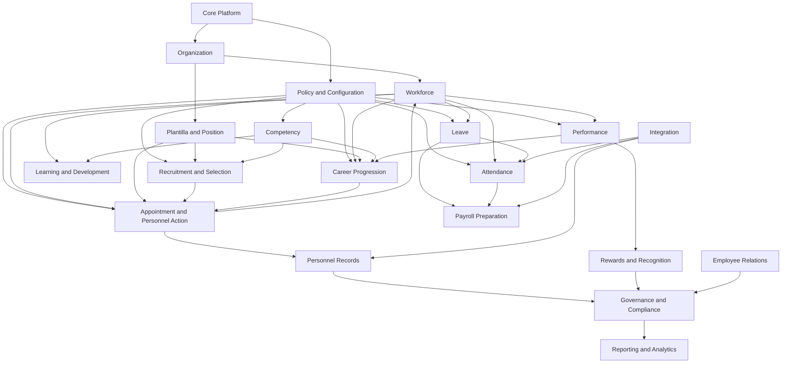

# Domain Dependencies

## Purpose

Define allowed dependencies, prohibited dependencies, event directions, reporting boundaries, and policy ownership for HRIS for DepEd.

## Foundation Domains

Core Platform, Organization, and Policy and Configuration provide foundations for the rest of the system.

## Allowed Dependency Direction

| Upstream Domain | May Be Used By |
| --- | --- |
| Core Platform | All domains for user, permission, audit, notification, and file-reference support. |
| Organization | All domains for office scope and hierarchy. |
| Policy and Configuration | Policy-driven domains for effective rules and versioned frameworks. |
| Workforce | Domains that need employee references and workforce status. |
| Plantilla and Position | Recruitment, Appointment, Career Progression, Payroll Preparation, Reporting. |
| Competency | Recruitment, Career Progression, Performance linkage, L&D, Rewards, Reporting. |
| Performance | Career Progression, L&D, Rewards, Governance, Reporting. |
| Personnel Records | Operational domains needing evidence references. |

## Prohibited Dependencies

- Recruitment and Selection must not issue appointments or update employee master records directly.
- Appointment and Personnel Action must not recalculate recruitment rankings or career assessments.
- Career Progression must not overwrite performance ratings or competency assessments.
- Reporting and Analytics must not modify operational source records.
- Integration adapters must not directly write final operational records without domain commands or approved import workflows.
- Personnel Records must not replace structured HR data with uploaded documents.
- Policy and Configuration must not own operational transaction records.
- Leave must not directly edit attendance logs, and Attendance must not directly edit leave ledgers.

## Event Publishing

| Domain | Potential Events |
| --- | --- |
| Workforce | EmployeeCreated, WorkforceStatusChanged, EmployeeSeparated |
| Plantilla and Position | ItemVacated, ItemEncumbered, PositionProfileUpdated |
| Recruitment and Selection | VacancyPublished, ApplicationSubmitted, EvaluationFinalized, RecommendationIssued |
| Appointment and Personnel Action | AppointmentIssued, CscActionRecorded, PersonnelMovementRecorded |
| Career Progression | CareerAssessmentFinalized, ReclassificationApproved, CareerProgressionRecommended |
| Competency | CompetencyAssessed, CompetencyGapIdentified |
| Performance | PerformanceRatingValidated, PerformanceSnapshotCreated |
| Learning and Development | IdpCreated, TrainingCompleted |
| Leave | LeaveApproved, LeaveLedgerPosted |
| Attendance | DtrGenerated, AttendanceAdjustmentApproved |
| Payroll Preparation | PayrollExportGenerated |
| Policy and Configuration | PolicyVersionApproved, AssessmentFrameworkPublished |

## Event Subscription

| Subscriber | Events of Interest |
| --- | --- |
| Personnel Records | AppointmentIssued, TrainingCompleted, RecognitionApproved, DocumentVerified |
| Workforce | AppointmentIssued, PersonnelMovementRecorded, SeparationRecorded |
| Plantilla and Position | AppointmentIssued, ItemVacated, ReclassificationApproved |
| Learning and Development | CompetencyGapIdentified, PerformanceRatingValidated |
| Payroll Preparation | LeaveLedgerPosted, AttendanceAdjustmentApproved, PersonnelMovementRecorded |
| Governance and Compliance | Major policy, audit, access, evaluation, appointment, and records events |
| Reporting and Analytics | Read-only event copies or projections from all domains |

## Cross-Domain Reporting

Reporting and Analytics may read across all domains using governed projections, views, or report queries. It must not own operational records, write corrections, or interpret policy independently.

## Policy Interpretation Ownership

Policy and Configuration owns the versioned policy configuration. Human HR/legal reviewers own policy interpretation. Operational domains consume approved versions and preserve snapshots.

## Potential Circular Dependency Risks

- Workforce and Appointment may become circular if employee current assignment is updated directly by both. Use appointment/personnel-action events and controlled workforce updates.
- Competency and Learning may become circular if training completion automatically changes competency. Require separate competency assessment.
- Leave and Attendance may become circular if leave creates attendance adjustments and attendance edits leave ledgers. Use reconciled references and approved commands.
- Recruitment and Appointment may become circular if appointment status alters rankings. Appointment may read recommendation snapshots only.
- Policy and operational domains may become circular if policies are edited from workflow screens. Policy changes must remain separate approvals.
