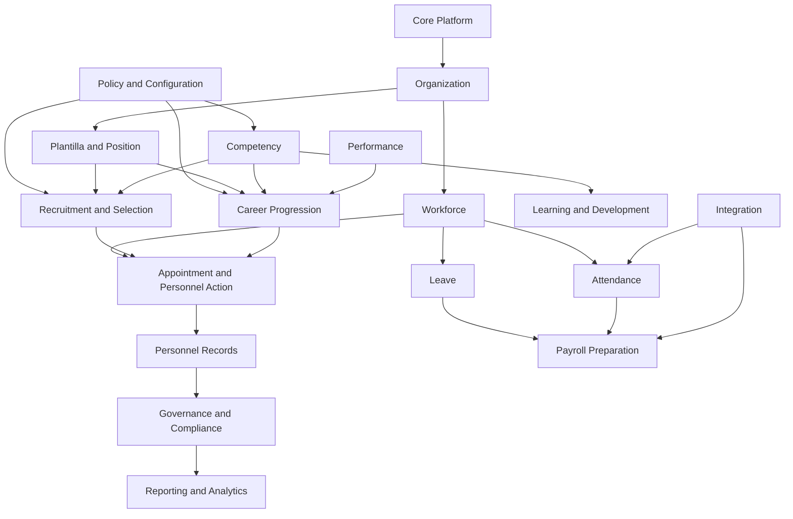

# Domain Map

## Purpose

Show the high-level bounded contexts for HRIS for DepEd and how they relate to DepEd HR operations, CSC frameworks, PRIME-HRM, CBHRMS, Data Privacy, and records management.

## Strategic Core Domains

| Domain | Why It Is Core |
| --- | --- |
| Organization | Controls Region, Division, District, School, IU, office scope, and visibility. |
| Workforce | Owns employee identity and employment relationship. |
| Plantilla and Position | Owns items, positions, salary grades, vacancy status, and position profiles. |
| Recruitment and Selection | Owns vacancy-to-recommendation workflows aligned with DepEd hiring rules. |
| Appointment and Personnel Action | Owns appointment, CSC action, assumption, movement, and personnel action history. |
| Career Progression | Owns higher teaching, Master Teacher, School Principal, reclassification, retitling, and conversion pathways. |
| Competency | Owns competency frameworks, evidence, assessments, gaps, and position competency profiles. |
| Policy and Configuration | Owns policy versions, assessment frameworks, QS versions, MSP versions, document sets, and workflow versions. |

## Supporting Domains

Performance, Learning and Development, Personnel Records, Leave, Attendance, Payroll Preparation, Rewards and Recognition, Employee Relations, Governance and Compliance, Reporting and Analytics, Integration, and Core Platform support the core HR lifecycle.

## Domain Relationships

## Policy Boundary

DepEd Orders, CSC ORAOHRA, PRIME-HRM, CBHRMS, Regional Memoranda, and Division Memoranda enter operational workflows through the Policy and Configuration Domain. Other domains consume approved policy versions; they do not invent or hardcode scoring, QS, document, or approval rules.
