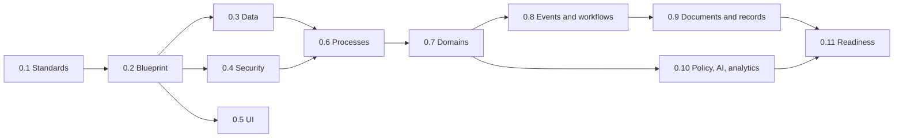

# Enterprise Architecture Review

## Phase review matrix

| Phase | Purpose and principal artifacts | Decisions/dependencies | Status | Gap and corrective action |
|---|---|---|---|---|
| 0.1 | Standards: naming, folders, Git, database, testing, API, UI | Laravel/Inertia conventions; auditable changes | Ready with minor corrections | Confirm actual commands and branch policy in WP-1. |
| 0.2 | Blueprint: domains, office hierarchy, security, workflow, integrations, roadmap | Laravel system of record; DepEd hierarchy; bounded modules | Conditionally ready | Convert conceptual organization hierarchy to an approved logical schema. |
| 0.3 | Data architecture and master lists | Relational truth, history, reference ownership | Conditionally ready | Approve identifiers, entity cardinalities, authoritative sources, retention and encryption fields. |
| 0.4 | Roles, permissions, scope and approval authority | Spatie capability + Policies + office/workflow scope | Conditionally ready | Create an executable Phase 1 permission catalog and temporary-authority rules. |
| 0.5 | UI shell and interaction system | Government-grade responsive, accessible UI | Ready with minor corrections | Validate component inventory and WCAG acceptance method. |
| 0.6 | 31 business-process specifications | Distinct DepEd processes, human approval | Requires policy clarification | Process owners must validate state names, deadlines, approvers, and current issuances before affected modules. |
| 0.7 | Enterprise domains, ownership, shared kernel | Single write owner; analytics read-only | Ready with minor corrections | Resolve a small number of cross-domain read-model/contracts during module design. |
| 0.8 | Workflow, events, notifications and queues | Facts are events; notifications are not truth; idempotency | Conditionally ready | Prove concrete workflow patterns before a configurable engine. |
| 0.9 | Documents, records, storage, signatures | Structured data distinct; originals preserved; PNPKI staged | Requires legal/records review | Approve retention schedules, holds, signature trust and storage controls before document implementation. |
| 0.10 | Policy, AI, analytics and decision support | Versioned policies; deterministic official rules; advisory AI | Conditionally ready | Validate policy inventory and defer AI/advanced analytics until prerequisites exist. |

## Architecture phase dependency map

## Findings

| ID | Severity | Evidence | Impact | Resolution |
|---|---|---|---|---|
| F-H01 | High | Policy documents intentionally avoid asserting unverified provisions. | Policy-sensitive modules cannot be accepted. | Policy validator confirms source, version, applicability and rule interpretation per module. |
| F-H02 | High | Data documents are conceptual and do not settle all keys/cardinalities. | Premature migrations could cause rework or history loss. | Approve Phase 1 logical model and identifiers before first migration. |
| F-H03 | High | Infrastructure capabilities are planned but not evidenced. | Private records, backups and queues may be unsafe. | Environment owner provides staging/production control evidence before affected deployment. |
| F-M01 | Medium | Several catalogs are broad future-state inventories. | Oversized implementation scope. | Enforce Phase 1 exclusions and small work packages. |
| F-M02 | Medium | Accessibility intent exists without a test protocol. | Inconsistent acceptance. | Adopt keyboard, screen-reader, contrast and automated checks. |

No critical contradiction was found in the documented architecture. A broken office-isolation implementation would be critical, so office scope remains an entry gate and acceptance gate.

