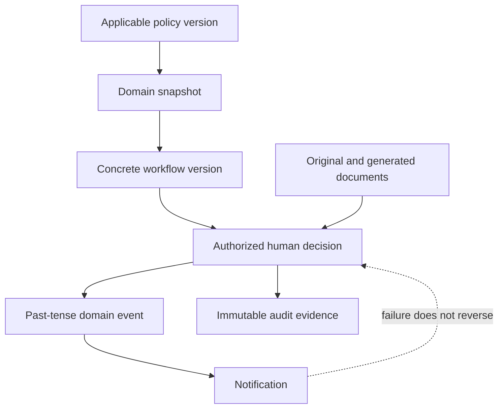

# Cross-Phase Consistency Review

## Contradiction and resolution register

| ID | Areas | Observation | Classification | Resolution |
|---|---|---|---|---|
| X-01 | Data / domains | Shared references are consumed widely but must have one write owner. | Clarification | Policy and Configuration owns configurable catalogs; Organization owns organizational master data; consumers reference IDs/snapshots. |
| X-02 | Workflow / domains | Generic workflow records could be mistaken for business state. | High risk, no current contradiction | Domain aggregate owns business decision; workflow coordinates assignments and transition evidence only. |
| X-03 | Documents / records | Documents may support but cannot replace structured service or appointment records. | Resolved principle | Preserve original evidence and link it to separately authorized structured records. |
| X-04 | Security / UI | Role-aware navigation can appear to authorize access. | Resolved principle | UI is convenience; server Policies, scoped queries and assignment checks decide. |
| X-05 | Recruitment / career actions | Similar assessment steps invite one generic process. | Resolved principle | Keep recruitment, appointment, promotion, career progression and reclassification separate; reuse proven primitives only. |
| X-06 | Policy / active transactions | New versions could alter in-flight or completed cases. | Resolved by ADR-003 | Snapshot applicable versions and inputs; never silently recompute official results. |
| X-07 | Analytics / operations | Cross-domain reads could become writes. | Resolved by ADR-007 | Analytics is read-oriented and cannot mutate operational truth. |
| X-08 | AI / decisions | Advisory output could be displayed as an official result. | Resolved by ADR-005/008/015 | Label, explain, human-review and record disposition; no autonomous official action. |
| X-09 | Audit / privacy | Broad payload capture conflicts with minimization. | Implementation clarification | Log identifiers, action, context and justified changes; redact secrets and unnecessary sensitive content. |
| X-10 | Reference data / policy | “Seeded” values may change by issuance. | High gap | Record provenance, version/effective dates and prohibit destructive reseeding. |

## Separation validation

Vacancy authorization → recruitment/application → qualification validation → assessment → comparative evaluation → HRMPSB deliberation → selection recommendation → appointment preparation → CSC action → onboarding is a chain of contracts, not one aggregate. Promotion, expanded career progression, reclassification, retitling, conversion, transfer, reassignment, detail and designation retain separate policy bases, records and approvals.

## Relationship of policy, workflow, documents and audit

## Consistency conclusion

The written architecture is consistent at principle level. Remaining gaps are approval and specification gaps. They must be resolved through ADRs and module traceability rather than silent code-level reinterpretation.

