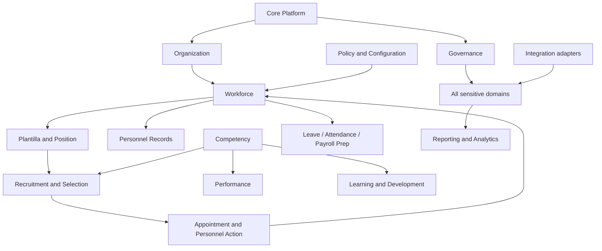

# Domain Boundary Validation

## Ownership matrix

| Domain | Owned truth / writes | Exposed reads and dependencies | Boundary/readiness |
|---|---|---|---|
| Core Platform | identity integration, shared technical context | user/context contracts | Foundation; conditional |
| Organization | offices, hierarchy, stations, user-office assignments | scoped office tree | Strong boundary; Phase 1 priority |
| Workforce | employee core and assignment history | personnel summary | Depends on Organization; later |
| Plantilla and Position | titles, salary grades, items, item assignments | vacancy/staffing views | Depends on references/workforce; later |
| Recruitment and Selection | vacancies, applicants, applications, assessments, deliberation | selected-candidate handoff | Must not own appointments |
| Appointment and Personnel Action | appointments, CSC actions, movements | appointment history | Separate transactional boundary |
| Career Progression | progression/reclassification pathway cases and evidence evaluation | readiness/outcome views | Separate from recruitment and promotion |
| Competency | dictionary, profiles, assessments and gaps | reusable competency views | Shared capability, not duplicated |
| Performance | cycles, commitments, ratings | validated rating summary | Depends on workforce/competency |
| Learning and Development | IDPs, interventions, participation | learning history | Depends on competency/workforce |
| Personnel Records | document metadata, 201-file links, service-record truth | authorized record views | Strong privacy/retention boundary |
| Leave | applications, credits and decisions | leave summary | Separate ledger/history |
| Attendance | time logs and adjustments | validated attendance summary | External device adapters only |
| Payroll Preparation | preparation and export batches | approved inputs | Does not own payroll disbursement |
| Rewards and Recognition | nominations, evaluation and awards | award history | Policy-sensitive later domain |
| Employee Relations | grievances/case links where authorized | restricted status only | Highly restricted boundary |
| Governance and Compliance | audit, authority/delegation, compliance evidence | audit/read models | Cross-cutting controls; no HR decision ownership |
| Reporting and Analytics | snapshots/read models/metric definitions | cross-domain reads | Read-only toward operational domains |
| Integration | adapters, deliveries, reconciliation | integration status | No bypass of domain authorization |
| Policy and Configuration | policy sources/versions/configuration | applicable version/rule contracts | No ownership of employee transactions |

## Domain dependency map

## Validation findings

- No god domain is required. Core Platform and Governance expose controls, not ownership of all business data.
- Cycles are managed with identifiers, snapshots and events rather than cross-domain table writes.
- Reporting, notification, workflow and document subsystems cannot make official HR decisions.
- Strong transactions stay inside an owning domain; cross-domain effects use explicit application contracts/events and idempotent consumers.
- Module-level commands, services and exact read contracts remain intentionally deferred until concrete implementation design.

## Command, event, authorization, and classification contract

For every domain row above, commands are imperative requests handled only by that owning domain (for example, assign an office, publish a vacancy, record an appointment, verify a document). Successful material changes emit minimal past-tense facts carrying stable identifiers. Consumers receive read contracts or events and never update another domain's tables.

Organization and public reference subsets are generally internal; Workforce, Plantilla assignment, Recruitment, Appointment, Career, Competency, Performance, L&D, Leave, Attendance and Payroll Preparation contain confidential employment or applicant data; Personnel Records and Employee Relations may contain restricted/highly sensitive records. Governance audit data inherits the classification of the action it evidences. Reporting and Integration outputs inherit the highest source classification and remain office-scoped.

Every write requires the domain permission and Laravel Policy, authorized office context, applicable assignment/authority, validation, and audit based on sensitivity. Typical events include `OfficeAssignmentChanged`, `ApplicationSubmitted`, `AssessmentFinalized`, `AppointmentRecorded`, `PersonnelActionCompleted`, `DocumentVerified`, and `PolicyVersionActivated`; exact names and payloads require module design approval. Domain services are justified only for rules belonging to that domain, while cross-domain orchestration remains an application workflow with explicit contracts.

## Gate

Before a module becomes development-ready, its owner, aggregate boundary, write operations, classifications, office scope, permission/policy matrix, events, audit and transaction boundary must be approved.
