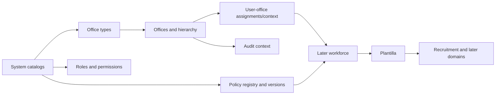

# Data Architecture Readiness

## Entity readiness matrix

| Entity group | Owner | History/scope | Key readiness gap | Status |
|---|---|---|---|---|
| Office types, offices, hierarchy, stations | Organization | effective-dated; organizational scope | approve subtype model, ancestry strategy, codes and cardinalities | Amber |
| User office assignments/context | Organization/Core | dated authority; user + office | delegation/default/active-context semantics | Amber |
| Policy and policy versions | Policy/Configuration | immutable active versions; applicability scope | minimum fields, precedence and approval states | Amber |
| Roles/permissions | Core/Governance | assignment history where material | initial catalog and business-authority separation | Amber |
| Employees/identifiers/contacts | Workforce | sensitive; office-linked; history where applicable | excluded from Phase 1; logical model review | Gray |
| Position titles/grades/items | Plantilla | effective-dated; unique official identifiers | authoritative sources and item uniqueness | Gray |
| Applications/assessments | Recruitment | case-scoped snapshots and immutable decisions | validated policy/configuration | Gray |
| Appointments/personnel actions | Appointment | append-oriented, effective-dated | CSC/policy validation | Gray |
| Documents/versions/signatures | Personnel Records | private, versioned, retention-controlled | records/signature approval | Red for implementation |
| Audit/activity records | Governance | append-only; actor/office/correlation | retention, redaction and growth plan | Amber |

## Reference-data ownership

| Class | Examples | Steward / source | Controls |
|---|---|---|---|
| National/DepEd | regions, divisions, schools, position groups | designated national/DepEd authoritative source | provenance, effective dates, no destructive delete |
| CSC/government | appointment/employment/eligibility types, salary grades | verified CSC/government issuance | version-aware, policy validator approval |
| Organization-maintained | units, sections, stations, local codes | authorized regional/division steward | office-scoped approval and audit |
| System-controlled | permission/workflow/policy type catalogs | technical owner with business review | idempotent release-managed seed |
| Policy-specific | document requirements, assessment categories | policy administrator/process owner | tied to policy version; immutable after use |
| User-configurable | limited display/configuration values | explicit steward | validation, scope and audit; never arbitrary deletion |

## Identifier decision gate

Use internal database keys only as storage implementation details. Before migrations, approve whether public references use ULID/UUID or generated non-sequential codes. Employee, applicant, application, item, workflow, document and policy identifiers must have documented uniqueness scope, format ownership and collision behavior. Sequential internal IDs must not appear in URLs/exports where enumeration creates risk. Correlation IDs must cross logs, jobs and integration deliveries without containing personal data.

## Migration order

## Migration controls

- Foreign-key and nullable-transition order must be explicit per migration set.
- Unique constraints protect official codes within their approved scope; indexes cover office, status, effective dates and common authorization filters.
- Completed official history is not soft-deleted; corrections append or supersede with reason and authority.
- Document binary data remains in approved private object/file storage; relational metadata remains authoritative.
- Encryption/search tradeoffs for high-risk identifiers require privacy/security review.
- Partitioning is deferred until measured volume requires it; audit/file growth needs retention and archive plans before production.

**Assessment: Amber.** Architecture is sufficient to design Phase 1, but C-02 identifier approval, C-03 logical organization model, and C-04 reference-source approval block the first production migration.

