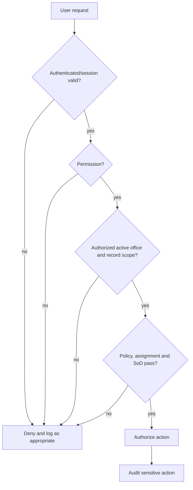

# Security and Authorization Readiness

## Decision model

Access requires all applicable checks: authenticated and verified session, broad permission, server-resolved active office within assignment dates, record office/ancestry scope, Laravel Policy decision, workflow/cycle assignment, temporary/delegated authority validity, record sensitivity, and segregation of duties. Technical administration never supplies HR approval authority.

## Permission readiness

| Control | Evidence | Gap | Rating |
|---|---|---|---|
| Permission naming/catalog | Phase 0.4 catalog | freeze Phase 1 subset | Amber |
| Record Policies | policy strategy | concrete Policies await entities | Amber |
| Office scope | hierarchy/scope rules | approve ancestry/query/context contract | Amber |
| Workflow/cycle assignment | security/workflow docs | concrete cases deferred | Gray |
| Delegation/acting capacity | authority architecture | persistence and revocation details | Amber |
| Restricted records/exports | document/security guidance | classification and reason rules | Amber |
| Authentication/session/CSRF/rate limits | Laravel baseline expected | WP-1 must verify actual config | Amber |
| Audit monitoring | audit architecture | alerts, retention and operational owner | Amber |

## Sensitive-action controls

| Action | Required controls |
|---|---|
| employee correction / appointment change | explicit permission + Policy + office scope + reason + old/new values + authority/policy basis + evidence + audit |
| evaluation reopening / score adjustment | cycle assignment + independent approval/SoD + immutable original + reason + policy snapshot + event/audit |
| policy activation / override | policy-admin permission distinct from technical admin + maker/checker + effective date + conflict review + audit |
| restricted document view/download/export | classification clearance + purpose/reason where required + scoped query + watermark/export controls where approved + access audit |
| delegation/acting authority | delegator authority + subject + scope + start/end + revocation + audit; never retroactive |
| impersonation | prohibit by default; if later approved, exceptional security permission, reason, banner, dual identity and immutable audit |

## Authorization test matrix

Required tests cover same-office allowed/denied, cross-office denied, region/division oversight within ancestry, school/IU restriction, inactive assignment, switched office context, assigned/unassigned workflow, HRMPSB cycle closure, evaluator assignment and recusal, temporary authority boundaries, delegated/acting identity in audit, employee own-record limits, applicant ownership, restricted document access, export permission, and technical-admin denial of HR approval.

**Assessment: Amber.** No critical design flaw is identified. C-05 requires approval of the Phase 1 scope contract and executable matrix before business data is introduced.

