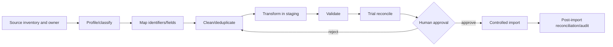

# Data Migration and Seeding Readiness

## Migration framework

Every future import from spreadsheets, databases, paper/201 files, plantilla, service, attendance, leave, applicant or document repositories requires source ownership, classification, lawful purpose, mapping/version, batch/correlation ID, original source reference/value where justified, corrected value/reason, validation status, exceptions, reconciliation totals, approver, rollback/compensation and immutable audit. Historical effective dates must survive normalization.

## Known blockers

No source inventories, sample profiles, data-owner approvals, quality measurements or identifier crosswalks are present. Therefore production data migration is **not ready**. Actual data must not be imported during architecture or Phase 1 foundation work.

## Seeder classification

| Category | Examples | Production rule |
|---|---|---|
| System-required | permission/policy/workflow type catalogs | release-controlled, idempotent |
| National/DepEd/CSC reference | office types, position/salary/appointment catalogs | verified source/version/provenance |
| Development/testing/demo | synthetic offices, users, scenarios | prohibited in production |
| Office-specific | local units/stations/configuration | authorized scoped import/maintenance, not universal seed |
| Policy-specific | document/assessment/rule configurations | bound to verified policy version and approval |

Production seeders must be deterministic, idempotent, non-destructive, traceable, reviewable, safe to rerun and tested for critical catalogs. Changed official values are superseded/effective-dated, not silently overwritten.

**Assessment: Red for legacy import; Amber for a small Phase 1 reference seeder set after C-04 source approval.**
