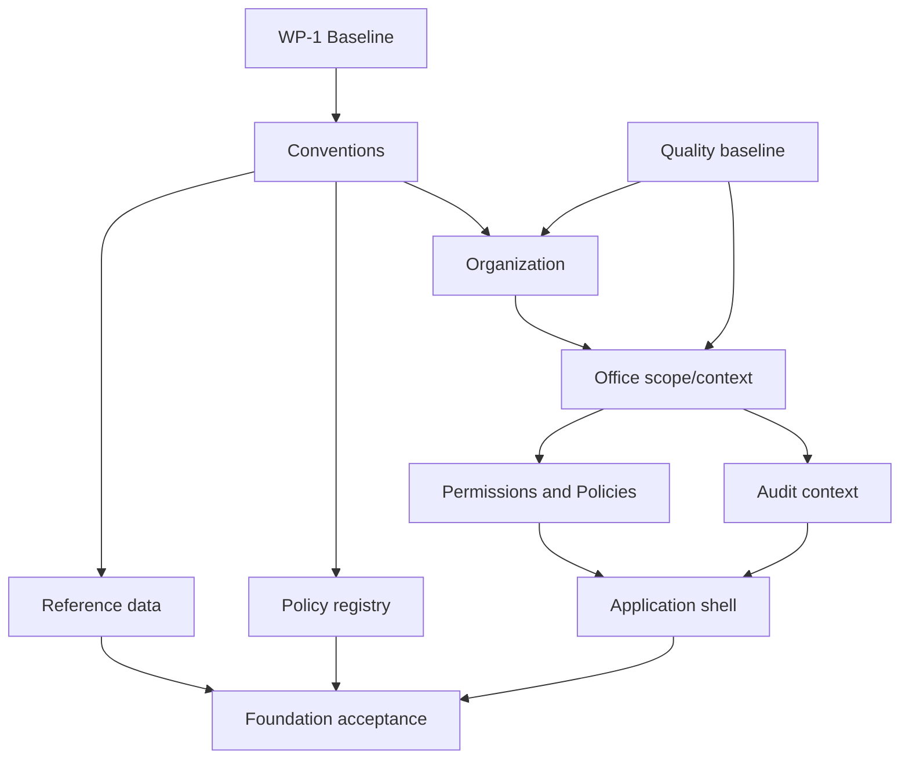

# Implementation Sequencing and Module Dependencies

## Module dependency matrix

| Code | Module/domain | Required predecessors | Key references/policy/control | Wave | Parallelism / block |
|---|---|---|---|---|---|
| FND-01 | Baseline/conventions | approved Phase 1 entry | standards and verified toolchain | Foundation | first; no production features |
| ORG-01 | Organization hierarchy | FND-01, identifier/reference approval | organization/data architecture; office management permissions | Foundation | can pair with UI design, not dependent schemas |
| SEC-01 | Office context/scope | ORG-01, user-office assignments | scope contract, Policies, cross-office tests | Foundation | blocks all sensitive modules |
| IAM-01 | Roles/permissions/authority | FND-01, SEC-01 contract | Phase 0.4, ADR-011/012 | Foundation | blocks protected routes |
| GOV-01 | Audit foundation | ORG/office context and audit minimum | security/audit standards | Foundation | blocks sensitive mutations |
| REF-01 | Core reference data | source/owner approval | seed provenance/version | Foundation | safe parallel after conventions |
| POL-01 | Minimal policy registry | identifiers, authority model | ADR-001–003/014 | Foundation | no generic rules engine |
| UI-01 | Application shell | auth baseline + scope/permission contracts | UI/accessibility architecture | Foundation | parallel design; integration after contracts |
| QUA-01 | Test/quality baseline | FND-01 | Pest/static/types/build | Foundation | continuous and blocking |
| WF-01 | Employee foundation | completed foundation | privacy, office scope, history | Workforce | excluded Phase 1 |
| PP-01 | Plantilla/position | workforce/ref foundations | official references, history | Plantilla | after workforce identity model |
| RS-01 | Recruitment/selection | PP-01, competency/QS/policy/workflow/document controls | validated MSP/DepEd policy, HRMPSB authority | Recruitment | blocked by policy validation |
| AP-01 | Appointment/CSC action | RS handoff + workforce/plantilla | ORAOHRA/CSC validation | Appointment | separate aggregate/process |
| CP-01 | Career progression/reclassification | workforce/plantilla/competency/policy/evidence | validated pathway rules | Later | separate from recruitment/promotion |
| REC-01 | 201/service/documents | workforce + private storage/records controls | retention/classification | Later | blocked by records approval |
| OPS-01 | Leave/attendance/payroll prep | workforce/scope/policy/integrations | CSC/office policy | Later | separate ledgers/adapters |
| TAL-01 | Competency/performance/L&D/rewards | workforce/position/policy | CBHRMS/SPMS/PRAISE validation | Later | competency can precede consumers |
| ANA-01 | Analytics/AI | mature validated data, lineage, privacy, audit | approved metrics/sources/vendors | Final | read/advisory only |

## Phase 1 foundation dependency map

## Phase 1 implementation sequence

Safe parallel work is limited to documentation/component design and independent references after contracts stabilize. Do not parallelize dependent database work against changing organization, identifier, office-scope or authority models.

