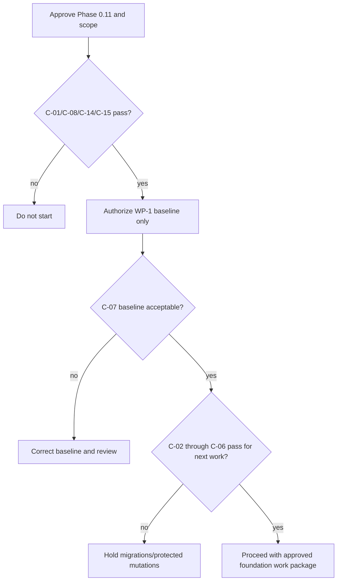

# Definition of Ready for Phase 1

## Entry checklist

| ID | Check | Class | Current status | Evidence/owner |
|---|---|---|---|---|
| C-01 | Phase 0.11 package and Conditional GO approved; named decision owners assigned | Mandatory | Pending | Project/System Owner |
| C-02 | Internal/public identifier strategy approved | Mandatory before migration | Failed | Architect/DB Reviewer |
| C-03 | Organization logical model, hierarchy cardinalities and office-scope contract approved | Mandatory before migration | Failed | Organization Owner/Architect/Security |
| C-04 | Initial reference catalog, authoritative sources, stewards and seed classifications approved | Mandatory before seeding | Failed | Data/Policy Owners |
| C-05 | Phase 1 permission, Policy, office-scope and authority matrix frozen | Mandatory before protected features | Failed | Security/HR Owner |
| C-06 | Audit minimum fields, redaction, sensitive actions and retention owner approved | Mandatory before mutation | Conditional | Governance/DPO/Records |
| C-07 | Existing packages/auth/routes/tests and quality commands verified non-destructively | Mandatory before WP-2 | Pending; WP-1 output | Lead Developer/QA |
| C-08 | Phase 1 scope/exclusions/work packages and change control approved | Mandatory | Pending | Project Owner/Architect |
| C-09 | Records retention/classification schedule validated | Required before records module | Deferred | Records/Legal/DPO |
| C-10 | Signature/PNPKI trust model validated | Required before signatures | Deferred | Legal/Security/Records |
| C-11 | Policy provisions/process states validated | Required before affected module | Deferred | Policy/HR Process Owner |
| C-12 | Staging/production, secrets, backup/restore, monitoring and DR evidenced | Required before production | Failed/deferred | Deployment Admin |
| C-13 | Accessibility acceptance protocol approved | Recommended before shell completion | Conditional | UI/QA |
| C-14 | RAID owners accept/mitigate blocking risks | Mandatory | Pending | Project Owner |
| C-15 | Baseline committed and unrelated working changes isolated | Mandatory before coding | Pending | Codex Operator/Lead Developer |

Phase 1 starts only when C-01 and C-08 are Passed and WP-1 is explicitly authorized. No migration may be created until C-02–C-04 pass. No protected mutation may be accepted until C-05–C-06 pass. C-07 is the first work package and gates all later work.

## Entry-gate flow

