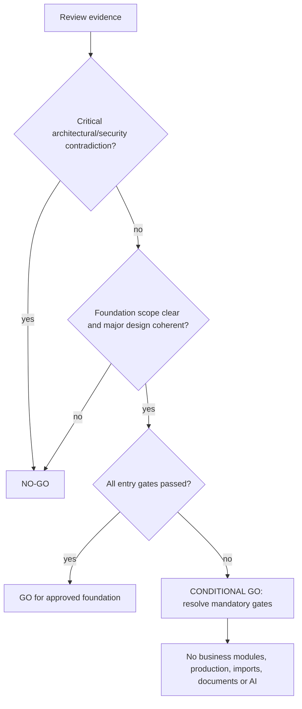

# Go / No-Go Assessment

## Scorecard

| Category | Rating | Finding/action/owner/block |
|---|---|---|
| Architecture completeness | Green | Major capabilities and principles covered; Architect maintains drift control. |
| Policy alignment | Amber | Sources named but provisions/applicability unverified; Policy Validator; blocks affected modules. |
| Domain clarity | Green | Ownership and separation are coherent; module boundary review remains required. |
| Data readiness | Amber | Conceptual model ready; identifiers/cardinalities/reference sources pending; blocks migration. |
| Security readiness | Amber | Defense model is sound; concrete scope/authority matrix pending; blocks sensitive records. |
| Authorization readiness | Amber | Permission catalog exists; executable Phase 1 subset/temporary authority pending. |
| Workflow readiness | Amber | Principles ready; concrete policy workflows not validated; blocks affected workflow. |
| Document readiness | Red | Retention/classification/storage/signature approvals absent; blocks document/signature work. |
| Audit readiness | Amber | Strategy exists; minimum event fields/redaction/retention ownership pending. |
| Testing readiness | Amber | Standards exist; current baseline not executed; WP-1 must verify. |
| UI foundation readiness | Amber | Shell architecture suitable; accessibility protocol/component criteria pending. |
| Integration readiness | Gray | Intentionally deferred; no external API assumed. |
| AI/analytics readiness | Red | Prerequisites absent; excluded from Phase 1 and production. |
| Infrastructure readiness | Red for production / Amber local | Production controls not evidenced; Deployment Admin; blocks production only. |
| Data migration readiness | Red | No source inventory/profile/crosswalk; blocks imports only. |
| Team/risk readiness | Amber | Named people and acceptance of RAID/gates required. |
| Phase 1 scope clarity | Green | Foundation inclusion/exclusion is explicit. |

## Decision flow

## Formal recommendation

**CONDITIONAL GO** for **Phase 1 — Core Foundation Implementation**, beginning only with Foundation Baseline Verification after explicit user/management authorization.

There are no documented critical architecture contradictions requiring enterprise redesign. However C-01, C-08, C-14 and C-15 must pass before WP-1; C-02–C-06 constrain subsequent Phase 1 work. Red areas are excluded and do not justify a full NO-GO for read-only baseline verification or controlled foundation planning.

