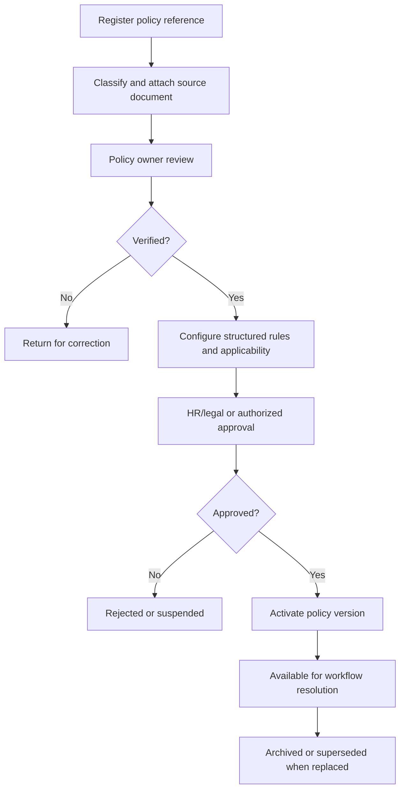

# 01 Policy Engine Overview

## Purpose

The Policy Engine centralizes policy registration, verification, activation, applicability resolution, version preservation, rule configuration, conflict detection, and policy-aware decision support.

## Boundary

The engine belongs to the Policy and Configuration Domain. It does not own recruitment applications, appointments, career progression records, employee profiles, documents, or analytics outputs. It provides approved policy versions, rule versions, framework versions, and applicability snapshots to operational domains.

## Major Components

| Component | Responsibility |
| --- | --- |
| Policy Registry | Stores DepEd, CSC, Regional, Division, local, and internal HR policy references. |
| Policy Version Manager | Controls immutable versions, effectivity, amendments, supersession, and activation. |
| Applicability Resolver | Determines which policy versions apply to a transaction. |
| Conflict Manager | Detects unresolved overlaps, missing rules, and hierarchy conflicts. |
| Rules Engine | Evaluates deterministic structured rules derived from approved policies. |
| QS Engine | Validates qualification standards with evidence and snapshots. |
| Assessment Engine | Configures assessment criteria, scoring, ranking drafts, and evaluation integrity. |
| Workflow Policy Mapper | Freezes workflow and policy configuration snapshots at workflow start. |
| Exception Manager | Handles equivalencies, substitutions, waivers, temporary authorities, and overrides. |
| Audit/Reproducibility Store | Preserves inputs, versions, outputs, reviewers, and explanations. |

## Policy Registration and Activation Lifecycle

## Non-Functional Expectations

Policy resolution must be traceable, performant for large applicant volumes, resilient to incomplete data, and auditable for historical queries. Active transactions must not be silently changed by later policy updates.
