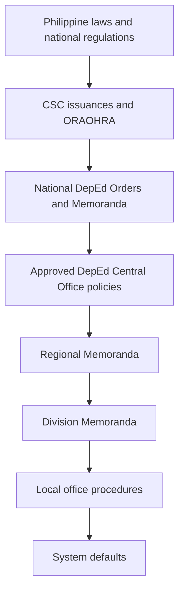
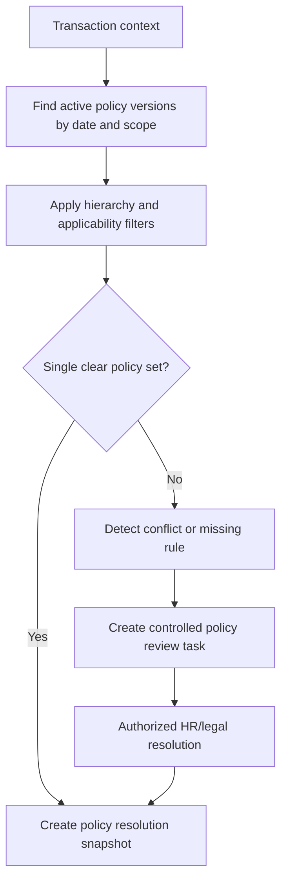
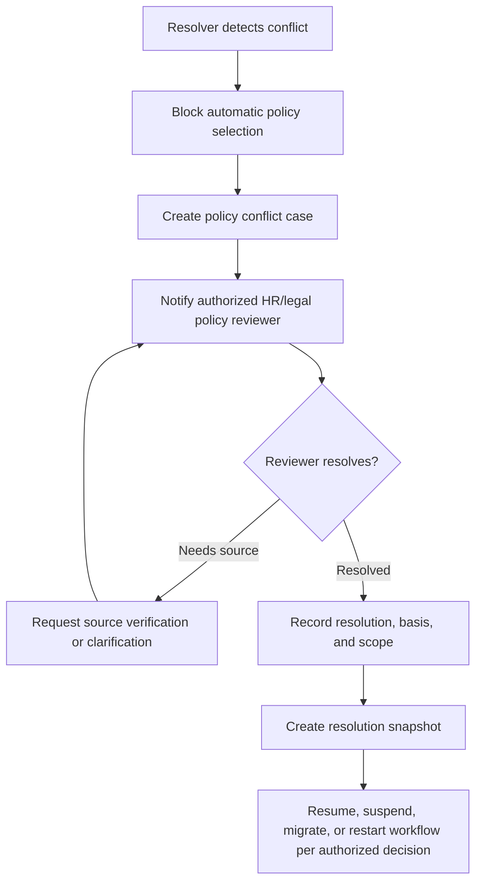

# 03 Policy Applicability and Resolution

## Purpose

Define how the system determines applicable policies for a transaction and handles conflicts without guessing silently.

## Policy Hierarchy and Precedence

Local policies may implement or clarify but must not override higher-level mandatory requirements. System defaults apply only when no policy-controlled rule is required.

## Applicability Inputs

Transaction date, application date, publication date, vacancy type, personnel category, position, position group, salary grade, job family, office type, Region, Division, District, School, Implementing Unit status, appointment type, promotion type, career-progression pathway, reclassification pathway, funding source, plantilla type, applicant status, employee status, special program, policy exception, and temporary authority.

## Resolution Flow

## Conflict Scenarios

Two active policies cover the same transaction, local policy conflicts with national policy, policy becomes effective during active workflow, transition provisions are unclear, policy is uploaded but unverified, structured rules are missing, retroactive effect is claimed, directive suspends a rule, temporary exemption exists, or emergency procedure applies.

## Policy Conflict and Escalation Flow

## Resolution Snapshot

Every official transaction must preserve selected policy versions, rejected alternatives, applicability inputs, resolver version, timestamp, user/system actor, office context, and warnings.
