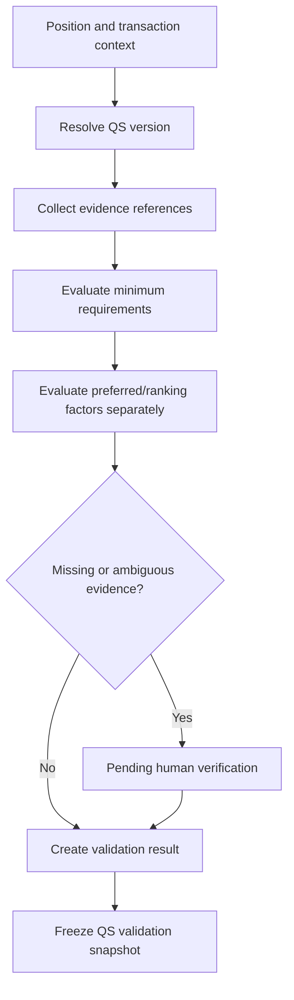

# 05 Qualification Standard Engine

## Purpose

Define a dedicated engine for Qualification Standards (QS), evidence validation, exceptions, and snapshots.

## Supported Requirements

Position-specific QS, position-group standards, salary-grade conditions, education, training, experience, eligibility, competency requirements, preferred qualifications, substitution rules, equivalency rules, special provisions, automatic/manual validation, human verification, version history, effective dates, applicability, exceptions, supporting evidence, and audit history.

## Distinctions

| Concept | Meaning |
| --- | --- |
| Minimum QS | Mandatory eligibility floor. |
| Preferred qualification | Advantage or ranking consideration unless policy says otherwise. |
| Ranking consideration | Scored or compared factor. |
| Competency expectation | Required or desired competency/proficiency. |
| Position-specific requirement | Requirement for a specific title/item/group. |
| Policy-specific gate | Eligibility/disqualification condition from policy. |

Preferred qualifications must not be treated as minimum eligibility unless the governing policy explicitly requires it.

## Conceptual Entities

`qualification_standard_sets`, `qualification_standard_versions`, `qualification_standard_items`, `qualification_requirement_groups`, `qualification_equivalencies`, `qualification_substitution_rules`, `qualification_validation_results`, `qualification_validation_snapshots`, `qualification_exceptions`.

## QS Evaluation Flow

## Audit Rule

Validation snapshots preserve QS version, evidence versions, result statuses, verifier, exceptions, and policy-resolution snapshot.
