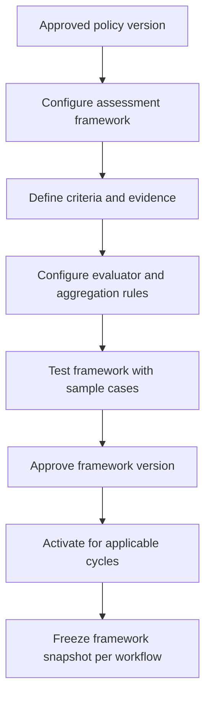

# 06 Assessment Configuration Engine

## Purpose

Design configurable assessment frameworks for DepEd recruitment, promotion, career progression, reclassification, and other comparative personnel actions.

## Covered Frameworks

Teacher I recruitment, higher teaching positions, Expanded Career Progression, Master Teacher progression, School Principal progression, teaching-related positions, non-teaching positions, executive/managerial positions, reclassification, and other DepEd personnel actions requiring comparative assessment.

## Assessment Components

Framework, framework version, criteria, subcriteria, maximum points, minimum thresholds, scoring scale, evidence requirements, evaluator type, number of evaluators, panel rules, aggregation method, rounding method, weighting, automatic computation, manual score, score justification, score adjustment process, review process, tie-breaking rules, disqualification conditions, deliberation requirements, ranking configuration, publication rules, and finalization rules.

## Configuration Flow

## Evaluation Integrity

Require assigned evaluators, conflict declarations, separate responsibilities where required, score attribution, reason/evidence for every manual score, locked finalized scores, controlled reopening, approval for changes, immutable score history, evaluation snapshot, policy references, and generated-output versioning.

## Aggregation Strategies

Sum, weighted sum, average, median, consensus, best valid score, panel-approved score, threshold gate, pass/fail gate, and ranked composite score. The selected strategy must be explicitly configured by framework version.

## Official Ranking Rule

The system may compute a deterministic draft comparative result. Official ranking requires completed evaluations, validation, HRMPSB review, deliberation where required, authorized confirmation, locking, finalization, and audit record. AI recommendations are never official rankings.
