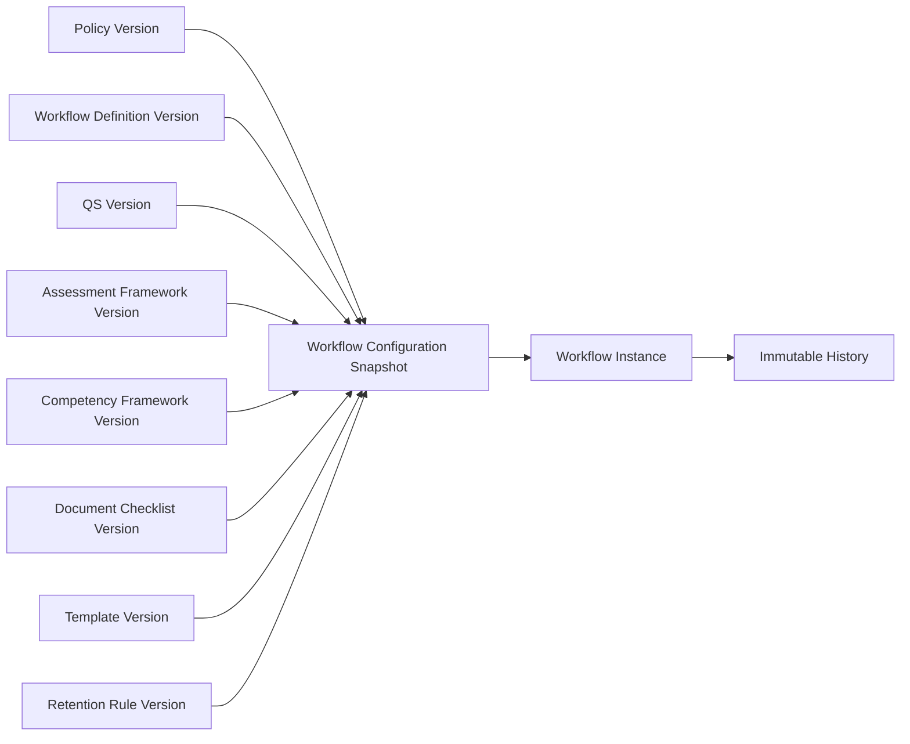

# 07 Workflow Policy Mapping

## Purpose

Define how policy versions connect to workflow versions and how active workflow instances preserve configuration snapshots.

## Mapping Components

Policy version, workflow definition, workflow version, Qualification Standard version, assessment framework version, documentary checklist version, competency framework version, approval-authority matrix, notification rules, deadline rules, output-template version, retention schedule, and required signatories.

## Snapshot Relationship

## Policy Change Strategies

| Strategy | Use |
| --- | --- |
| Continue under original policy | Default for active workflows unless transition says otherwise. |
| Migrate under explicit transition provision | Use when policy gives clear transition rule. |
| Restart under new policy | Use when old workflow cannot continue and policy permits restart. |
| Authorized case-by-case migration | Requires HR/legal approval and audit. |
| Suspend for policy review | Use when applicability conflict is unresolved. |
| Revalidate specific stages only | Use when transition targets only selected steps. |

Every transition must be authorized and audited.
