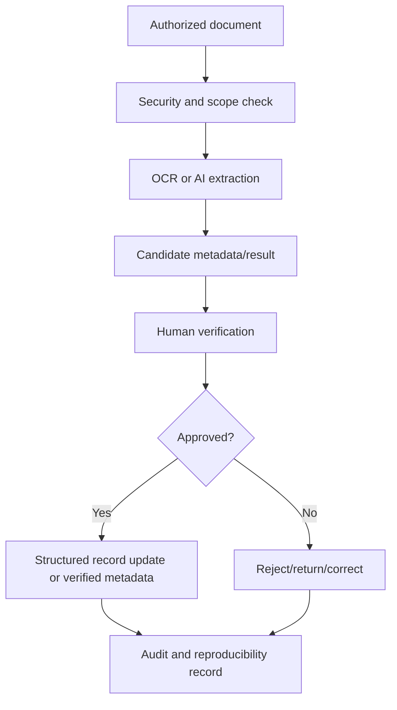

# 11 AI Document and Record Assistance

## Purpose

Define AI/OCR assistance for documents and records while preserving human verification and records integrity.

## Supported Assistance

Document classification suggestions, metadata extraction, OCR text extraction, duplicate detection, missing-document detection, anomaly flags, summary of applicant/employee evidence, retention classification hints, and audit packet summaries.

## Controls

- Original files are preserved.
- Extracted data is not official until verified.
- AI classifications are reviewable and reversible.
- OCR confidence and model/prompt version are recorded.
- Sensitive records require approved processing environment.
- Public or unapproved AI services must not receive sensitive HR documents.

## Document Assistance Flow

