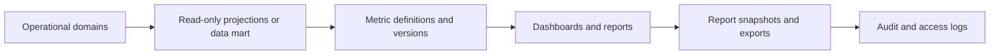

# 13 Workforce Analytics Architecture

## Purpose

Define read-oriented workforce analytics that support planning without modifying operational records.

## Analytics Categories

Vacancy analytics, workforce count, retirement projection, critical-position analysis, plantilla occupancy, turnover/separation patterns, competency gap trends, learning needs, promotion-readiness trends, leave/attendance patterns, and data-quality alerts.

## Analytics Data Flow

## Rules

- Analytics may read across domains but must not write operational records.
- Metrics must have definitions and versions.
- Office scope applies to every dashboard and export.
- Individual sensitive details must not be exposed in executive dashboards unless explicitly authorized.
- Dashboard data freshness and source lineage must be visible.
