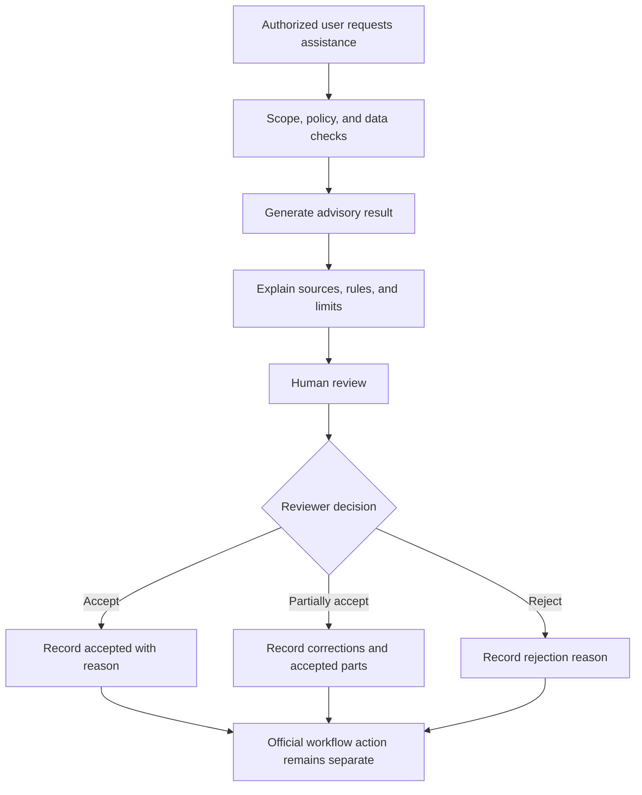

# 16 Decision-Support Architecture

## Purpose

Define a Decision-Support Service separate from official decision authority.

## Use Cases

Policy selection assistance, qualification-evidence review, documentary-completeness review, evaluator-assignment suggestions, panel-composition suggestions, conflict-of-interest warnings, deadline-risk alerts, vacancy-priority analysis, critical-position analysis, competency matching, development recommendations, promotion-readiness indicators, succession-readiness indicators, retirement-impact projections, workforce-deployment scenarios, training prioritization, compliance-risk detection, and audit-risk detection.

## Recommendation States

Generated, Awaiting review, Accepted, Partially accepted, Rejected, Expired, Superseded, Withdrawn, Invalidated, Requires more data.

## Human-Reviewed AI Recommendation Flow

## Rule

Rejecting an AI recommendation must not be treated as user error.
