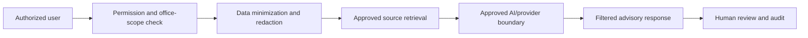

# 18 AI Security, Privacy, and Risk Controls

## Purpose

Define AI privacy, security, and risk controls for government HR records.

## Required Controls

Data minimization, purpose limitation, consent where applicable, lawful processing, restricted data handling, PII protection, personnel/applicant record controls, health/disciplinary data restrictions, government identifier protection, access logging, encryption, data residency review, external provider review, API security, prompt-injection protection, data exfiltration monitoring, model-inversion risk review, unauthorized training prohibition, retention, deletion, incident response, breach response, vendor termination, and model suspension.

## External AI Deployment Options

| Option | Use |
| --- | --- |
| Local deterministic services | Preferred for official computations. |
| Private-hosted AI | Possible for controlled advisory use. |
| Government-approved cloud AI | Possible with governance and contracts. |
| Approved external API | Requires contractual controls and opt-out from training. |
| Fully offline processing | Preferred for highly restricted records. |

## AI Request Security Boundary

## Prompt and Retrieval Security

Address prompt injection, malicious uploaded documents, hidden text, untrusted sources, unauthorized retrieval, cross-office leakage, retrieval-scope enforcement, source validation, citation requirements, and response filtering.
