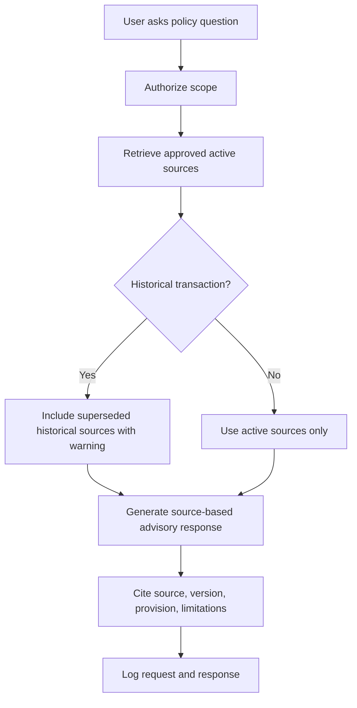

# 19 Knowledge Base and Policy Retrieval

## Purpose

Design an approved HR knowledge base for policy assistance, retrieval, and advisory responses.

## Knowledge Sources

DepEd Orders, DepEd Memoranda, CSC issuances, ORAOHRA provisions, Qualification Standards, Merit Selection Plans, PRIME-HRM references, competency dictionaries, position competency profiles, SPMS guidance, PRAISE guidance, Regional Memoranda, Division Memoranda, approved office procedures, FAQs, SOPs, official templates, and records-retention rules.

## Source Statuses

Draft, Pending verification, Verified, Approved, Active, Superseded, Archived, Suspended, Rejected.

## Retrieval Flow

## Response Rules

Policy-assistance responses must cite the source, identify issuance number and year, identify applicable provision, identify policy version, state advisory status, show conflicts, state when human interpretation is required, and avoid inventing policy provisions. If no approved source supports an answer, say the information could not be confirmed.
