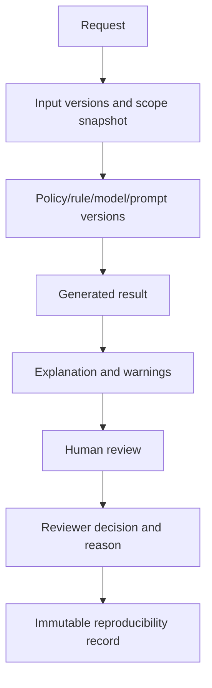

# 22 Audit, Retention, and Reproducibility

## Purpose

Define immutable audit, retention, and reproducibility records for policies, rules, AI, and analytics.

## Audited Actions

Policy registration, verification, approval, activation, supersession, rule changes, rule activation, applicability results, policy conflicts, exceptions and overrides, AI requests, AI responses, recommendation reviews, dashboard access, report generation, data export, restricted analytics, model deployment, model updates, knowledge-source changes, and security incidents.

## Required Audit Fields

User, role, acting capacity, office context, timestamp, action, entity, old values, new values, reason, policy reference, workflow reference, related documents, IP/device context where appropriate, and correlation ID.

## Recommendation Audit and Reproducibility Flow

## Reproducibility Requirements

Deterministic results preserve enough inputs and versions to regenerate the same result. Non-deterministic AI output preserves request, model version, configuration, prompt version, knowledge sources, output, warnings, and review record.

## Retention

Retention is policy-driven. High-impact recommendation records, policy resolution snapshots, rule evaluations, ranking-related assistance, and restricted analytics access should be retained according to official records schedules after validation.
