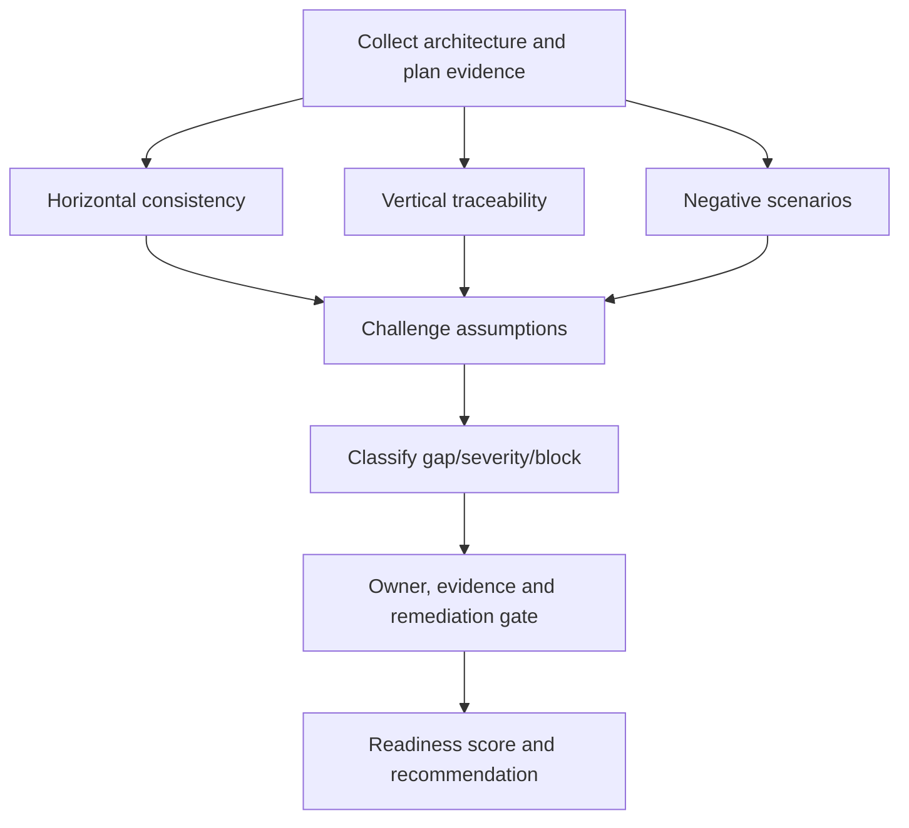
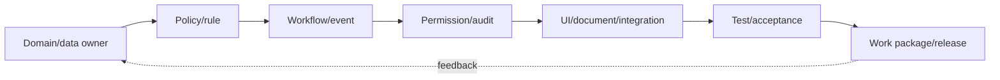

# Validation Scope and Methodology

## Evidence

Required `.codex` rules; project standards; architecture blueprint, data, security, UI, processes, domains, events/workflows, documents/records, competency, policy/AI/analytics; ADRs; Phase 0.11 readiness package; and Phase 0.12 implementation package. Conclusions cite those source groups, related domain/work package, risk, acceptance and test consequences.

## Techniques

- Horizontal: compare ownership/data, policy/rule/workflow, permission/UI, document/record, event/audit, analytics/write model and work-package/dependency.
- Vertical: trace selected DepEd processes from authoritative-policy validation through requirement, process, domain, entity/rule, workflow, permission, document, event, audit, test and work package.
- Negative: test missing/conflicting policy, incomplete/historic data, unauthorized office, permission without authority, delivery/upload/API/AI failure, reopening, policy change, reorganization, expired delegation and legal hold.
- Challenge: seek counterexamples and unsafe assumptions; planning statements do not close findings without approved design or executable evidence.

Statuses are validated, validated with conditions, partial, missing, contradictory, deferred, blocked, or requiring policy/management/technical decision. No numerical coverage percentage is used because the architecture lacks a fully enumerated atomic requirement baseline.

