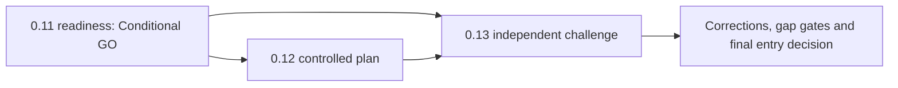

# Architecture Completeness Validation

| Area | Classification | Evidence and remaining condition |
|---|---|---|
| Core Platform / Organization | Sufficient for Phase 1 | blueprint/domain/data/security; identifiers, hierarchy cardinality, restructuring rules and source ownership pending |
| Workforce | Partially complete | domain/process/data cover core/history; appointment ownership wording needs correction and field-level privacy remains module design |
| Plantilla/Position | Partially complete | entities/history/vacancy covered; authoritative references and temporal uniqueness pending |
| Recruitment/Selection | Requires policy validation | full process architecture exists; MSP/DepEd provisions, HRMPSB rules and retention not verified |
| Appointment/Personnel Action | Requires policy validation | separate domain/process exists; CSC/ORAOHRA/signatory/action rules unverified |
| Career Progression | Requires policy validation | separate pathways represented; exact current rules and evidence remain gated |
| Competency/Performance/L&D | Deferred appropriately | CBHRMS backbone and consumers modeled; framework ownership/version approval pending |
| Personnel Records/Documents | Partially complete / blocked | lifecycle/security/versioning modeled; retention, holds, storage and signature trust unapproved |
| Leave/Attendance/Payroll Prep | Partially complete / deferred | boundaries and processes exist; exact ledgers/rules/integrations later |
| Rewards/Relations/Separation | Partially complete / deferred | processes/domains present; restricted/legal/policy rules later |
| Governance/Audit/Security/Privacy | Sufficient for foundation with conditions | defense model sound; executable scope/authority/audit minimum absent |
| Workflow/Events/Notifications | Sufficient as patterns only | concrete-first ADR; suspension/reopening/quorum/deadlines need module criteria |
| Policy/Configuration | Sufficient for minimal registry | hierarchy/conflict/version concepts exist; authoritative content not validated |
| Reporting/Analytics | Deferred appropriately | read-oriented principle sound; metrics/lineage/freshness unavailable |
| Integration/Infrastructure | Requires management/technical decision | adapters and controls planned; providers, environments, RPO/RTO and APIs unconfirmed |
| UI/Accessibility | Sufficient for shell with conditions | component/shell plan exists; test protocol and acting/restricted/advisory indicators need acceptance criteria |
| AI/Decision Support | Deferred appropriately | advisory/prohibited rules strong; provider/model/prompt/retrieval/incident controls not implementation-ready |

No missing top-level HR domain was found. Completeness is conceptual, not migration-ready or policy-approved. Phase 1 remains foundation-only.

