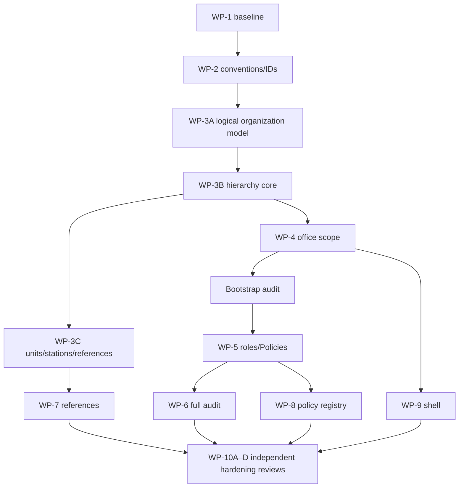

# Phase 0.12 Plan Validation

## Work-package validation

| WP | Classification | Evidence/challenge and required revision |
|---|---|---|
| WP-1 Baseline | Validated with conditions | read-only/non-destructive scope is safe; C-01/08/14/15 and explicit approval still block execution |
| WP-2 Conventions | Validated with conditions | must remain documentation/justified primitives; identifier ADR C-02 required before downstream schema |
| WP-3 Organization | Must be split | too many entities, schema, seed, backend and UI concerns; split logical model/IDs, office types/hierarchy, units/stations, seed provenance and acceptance increments |
| WP-4 Office Scope | Validated with conditions | depends on accepted hierarchy; add restructuring, inactive ancestor, concurrent context and default-context negative cases |
| WP-5 Roles/Permissions | Validated with conditions | add explicit authority validity/recusal and bootstrap audit; technical admin denial preserved |
| WP-6 Audit | Requires resequencing clarification | minimal audit must exist before privileged scope/role mutations; define bootstrap audit before full audit foundation |
| WP-7 References | Validated with conditions | C-04 source/steward gate; separate system catalogs from external official data and local configuration |
| WP-8 Policy Registry | Validated with conditions | minimum registry only; define retroactive/transition/local applicability metadata without implementing generic precedence logic |
| WP-9 Shell | Validated with conditions | acting capacity, restricted record, draft/final/advisory states and stale office context must be visible/tested |
| WP-10 Hardening | Must be split by review evidence | integration is acceptable as an epic, but security/privacy/data/UX/QA acceptance should be independently trackable subpackages |

## Sequence correction

Migration order is safe at wave level but cannot be approved until IDs, temporal constraints, rollback/forward-repair and hierarchy modeling are concrete. No cross-domain write access, premature AI, generic engine or unsafe business module was introduced.
