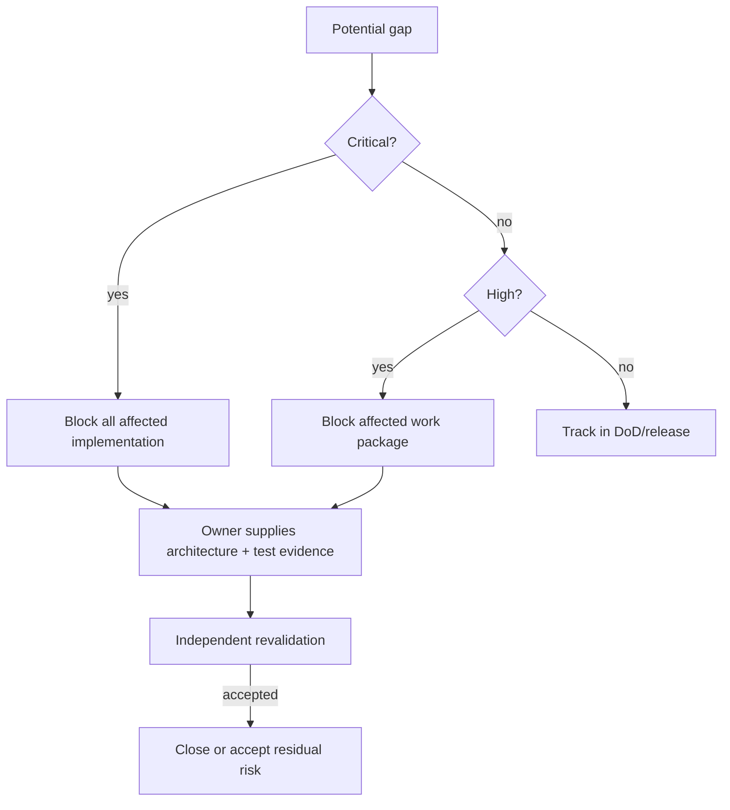

# Security, Privacy, and Authorization Gap Review

| Threat / asset | Gap | Severity | Control/test | Phase/block |
|---|---|---|---|---|
| cross-office leak / personnel-applicant records | ancestry/context contract not approved | Critical if implemented incorrectly | server-scoped queries; same/cross/oversight/restructure tests | C-03/05; blocks sensitive modules |
| horizontal/vertical escalation | permission may be confused with record/business authority | High | Policy + scope + assignment/SoD; technical-admin denial | WP-4/5 |
| expired delegation/acting authority | exact validity/revocation model absent | High | dated scope, revocation, dual identity audit; boundary tests | before delegated actions |
| HRMPSB/evaluator leakage | cycle/assignment/recusal archival access unvalidated | High | case assignment, closure/recusal tests | recruitment |
| restricted file/export | classification/justification controls not approved | High | authorized download, non-guessable delivery, access/export audit | records/export modules |
| employee/applicant self-service | editable/viewable field matrix missing | High by module | owner + Policy + field serialization tests | affected module |
| analytics/AI cross-scope retrieval | row/document filtering contracts absent | Critical if enabled | scoped retrieval, restricted dimensions, adversarial cross-office tests | AI/analytics blocked |
| unlogged sensitive access | access-event minimum C-06 open | High | reason/context/access audit and monitoring | protected mutations/files |
| auth/session/headers | baseline assumed, not verified | Medium | WP-1 configuration/route inspection | WP-1 output |
| integration inbound bypass | adapter plan states control, concrete contract absent | High by integration | authenticated adapter → validated authorized command; negative tests | affected integration |

Security architecture is defensible but not executable until C-03/05/06. UI visibility cannot close these gaps.

