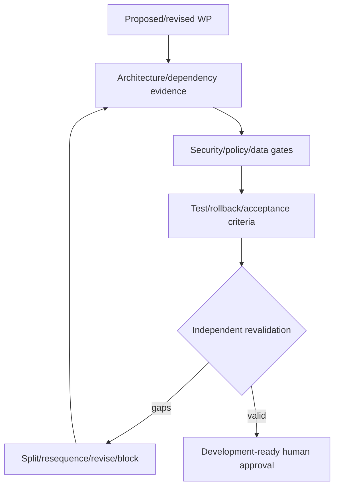

# Implementation Sequence Risk Review

| Sequence assertion | Result | Risk/correction |
|---|---|---|
| organization before business modules | Valid | split WP-3 and approve historical restructuring first |
| office scope before employee/applicant access | Valid | C-03/05 remain blocking |
| authorization/audit before sensitive actions | Requires clarification | add bootstrap audit before role/scope mutations; full audit follows authority context |
| references/policy registry before dependents | Valid with sources gate | C-04/policy validation |
| workforce before plantilla assignment | Valid | position catalogs may be independent; item occupancy needs workforce |
| plantilla before vacancy/recruitment | Valid | formal authorized-vacancy handoff needed |
| recruitment before appointment handoff | Valid | ownership/correction contract needed |
| appointment before full service automation | Valid | Workforce must not own appointment truth |
| competency before competency analytics | Valid | framework/metric validation required |
| structured mature data before AI | Valid | AI remains blocked |

Unsafe parallel work includes changing office hierarchy while scope queries are implemented; permission/audit contracts in competing branches; reference schemas before source/ID decisions; shell office switching before server context; and dependent migrations against unsettled temporal models. WP-3 and WP-10 must split. Migration waves require entity-level rollback/forward-repair and lock-risk review before approval.

