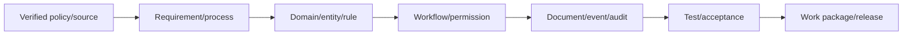

# Traceability Coverage Analysis

| Domain group | Upstream policy/process | Domain/data/rule | Permission/workflow/document/event/audit | Tests/work package | Classification |
|---|---|---|---|---|---|
| Organization/Core | architecture/requirements identified | owner/entities conceptual | permission/scope/audit patterns | WP-2–6; tests listed | Partially traced; IDs/cardinality/source/test implementation missing |
| Policy/References | issuance areas named | registry/version model | activation authority/audit | WP-7/8 | Partially traced; authoritative provisions missing |
| Workforce | process/domain/data present | ownership mostly clear | privacy/scope/history patterns | Wave 2 | Partial; appointment ownership correction and downstream implementation missing |
| Plantilla | sources/process/domain present | entities/history present | permissions/events/report scope | Wave 3 | Partial; authoritative sources and temporal constraints missing |
| Recruitment/HRMPSB | policy titles/processes rich | domain/rules configurable | workflows/docs/events/audit mapped | Wave 4 | Partial; policy provisions, test cases and implementation missing |
| Appointment/Career | policy areas/processes/domains present | separate ownership present | authority/docs/history mapped | Waves 5/6 | Partial; policy states/handoffs/tests missing |
| Competency/Performance/L&D | PRIME-HRM/CBHRMS sources/processes | shared model present | permissions/evidence/events | Wave 7 | Partial/deferred; framework validation missing |
| Records/Admin | records/privacy/processes | structured/file distinction present | access/retention/audit planned | Wave 8 | Partial/blocked; schedule/storage/signature missing |
| Rewards/Relations/Separation | process/domain present | conceptual entities/boundaries | restricted authority/records planned | Wave 9 | Partial/deferred; policy/legal tests missing |
| Analytics/Integration/AI | governance sources/principles | read/advisory boundaries | scoped adapters/review/audit | Wave 10 | Deferred; metrics/providers/test evidence missing |

Coverage is strongest at architecture and process levels, partial at policy-provision, field-level entity, concrete rule/workflow and executable-test levels, and intentionally missing at implementation. No percentage is claimed because atomic trace items have not been fully enumerated. Every future backlog item must close its vertical chain before Development Ready.

