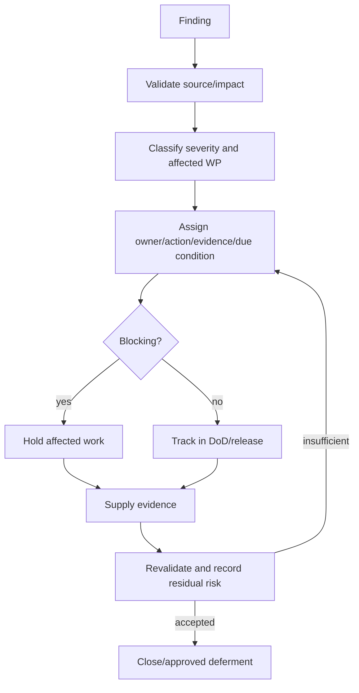

# Gap Register and Remediation Plan

| ID / title | Category/source/domain/process/WP | Sev/P/I | Block | Remediation / owner / evidence / due | Status / residual |
|---|---|---|---|---|---|
| G-001 Phase 1 approvals | Governance; 0.11 C-01/08/14/15; WP-1 | High/H/H | WP-1 | approve decision/scope/RAID/clean baseline; Project/Lead; signed records/Git evidence; before WP-1 | Open; Low after approval |
| G-002 Identifier strategy | Data; C-02; Core; WP-2/3 | High/H/H | migrations | ADR with internal/public/reference rules; Architect/DB/Security; examples/collision/privacy review | Open; Low |
| G-003 Organization history | Data/security; C-03; Organization; WP-3/4 | High/M/H | org migration/scope | define effective parentage/restructure/closure/ancestry snapshots; Org/Architect/Security; scenarios/logical model | Open; Medium |
| G-004 Reference provenance | Data/policy; C-04; WP-7 | High/H/H | production seed | source/steward/version register; Data/Policy; approvals/idempotency plan | Open; Low |
| G-005 Executable authority model | Security; C-05; WP-4/5 | High/M/H | protected features | permission/Policy/scope/delegation/SoD matrix; Security/HR; negative test specification | Open; Medium |
| G-006 Audit/bootstrap | Audit; C-06; WP-5/6 | High/M/H | privileged mutation | define bootstrap/full event fields, redaction/retention; Governance/DPO/Records; catalog/tests | Open; Low |
| G-007 Baseline/tooling unknown | Quality; C-07; WP-1 | Medium/H/M | WP-2 | execute approved WP-1; Lead/QA; command results/report | Open; Low |
| G-008 WP-3 oversized | Delivery; Phase 0.12 WP-3 | Medium/H/M | WP-3 development | split 3A–3C plus acceptance; Architect/Project; revised backlog | Open; Low |
| G-009 WP-10 acceptance epic | Delivery; WP-10 | Medium/M/M | Phase 1 closure | split technical/security/privacy/data/UI/QA evidence; Project/QA | Open; Low |
| G-010 Appointment ownership ambiguity | Domain; Waves 2/5; Workforce/Appointment | High/M/H | Workforce model | Appointment owns truth; define read/handoff; Architect/HR; updated domain/backlog/ADR | Open; Low |
| G-011 Policy provisions/transitions | Policy; traceability; affected domains | High/H/H | affected module | authoritative validation including retroactive/transition/local rules; Policy/HR; signed matrix | Open; Medium |
| G-012 Workflow exceptional states | Workflow; processes; later modules | High/M/H | affected workflow | specify suspend/cancel/reopen/quorum/deadlines; HR/Policy/Architect; state/tests | Open; Medium |
| G-013 Records/holds/signatures | Records; C-09/10 | High/H/H | records/signature | approve schedule, holds, storage and trust; Records/Legal/Security/DPO | Open; Medium |
| G-014 Accessibility/states | UI; C-13; WP-9 | Medium/M/M | WP-9 acceptance | protocol plus context/acting/restricted/draft/advisory cases; UI/QA | Open; Low |
| G-015 Production/DR/observability | Infrastructure; C-12 | High/H/H | production | RPO/RTO, restore/failover, monitoring/runbooks; Deployment/Security; exercise evidence | Open; Medium |
| G-016 Legacy migration | Data migration | High/H/H | imports | inventory/profile/map/trial/reconcile/approve; Data/DB/DPO; trial evidence | Deferred; Medium |
| G-017 AI/retrieval/metrics | AI/analytics | Critical if enabled/M/H | all AI | keep disabled; later provider/model/retrieval/privacy/bias/metric architecture; System/DPO/Security/HR | Deferred; High until controls |

