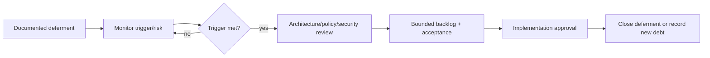

# Deferred Decisions and Technical Debt Register

| ID / item | Reason/current workaround | Risk/trigger | Required architecture / intended phase / owner | Status |
|---|---|---|---|---|
| DD-01 Generic Rules Engine | concrete patterns unproven; module-specific deterministic rules | coupling; reconsider after multiple validated rule families | versioned grammar/security/sandbox/migration; later policy phase; Architect/Policy | Deferred |
| DD-02 Workflow Designer | concrete workflows unvalidated; explicit workflows | false generalization; trigger repeated stable transitions | versioning/authority/migration/UX; later workflow phase; Architect/HR | Deferred |
| DD-03 Advanced AI | data/privacy/security immature; no AI | breach/bias; trigger mature approved sources/data/review | provider/model/retrieval/incident/evaluation; Wave 10; System/DPO/Security | Deferred |
| DD-04 Predictive analytics/warehouse | no mature data/metrics; operational reports later | misleading forecasts; trigger accepted data lineage/volume | warehouse/snapshots/governance; Wave 10; Analytics Owner | Deferred |
| DD-05 PNPKI production | trust/provider unapproved; unsigned/manual approved process | invalid signature; trigger legal/security approval | certificate/timestamp/revocation/archive; signature phase; Records/Security | Deferred |
| DD-06 CSC/DepEd external APIs | APIs unconfirmed; adapter placeholders/manual exchange | delay/vendor change; trigger official contract/sandbox | contracts/auth/reconciliation; integration phase; Integration Owner | Deferred |
| DD-07 Mobile application | web responsive shell first | duplicated security/UX; trigger approved use cases | API/device/offline/security; later; System Owner | Deferred |
| DD-08 Full payroll | system is payroll preparation only | scope/financial risk; trigger formal mandate | finance/legal/integration domain review; future; System/Finance | Deferred |
| DD-09 Legacy migration tooling | sources unknown; controlled manual analysis | data loss; trigger source inventory | staging/crosswalk/reconcile/rollback; pre-import; Data Owner | Deferred |
| DD-10 Performance/partitioning | volumes unmeasured; indexes/pagination | late scaling; trigger measured thresholds | workload/retention/archive plan; affected wave; Architect/DB | Deferred |

Undocumented omissions are gaps, not accepted technical debt.

