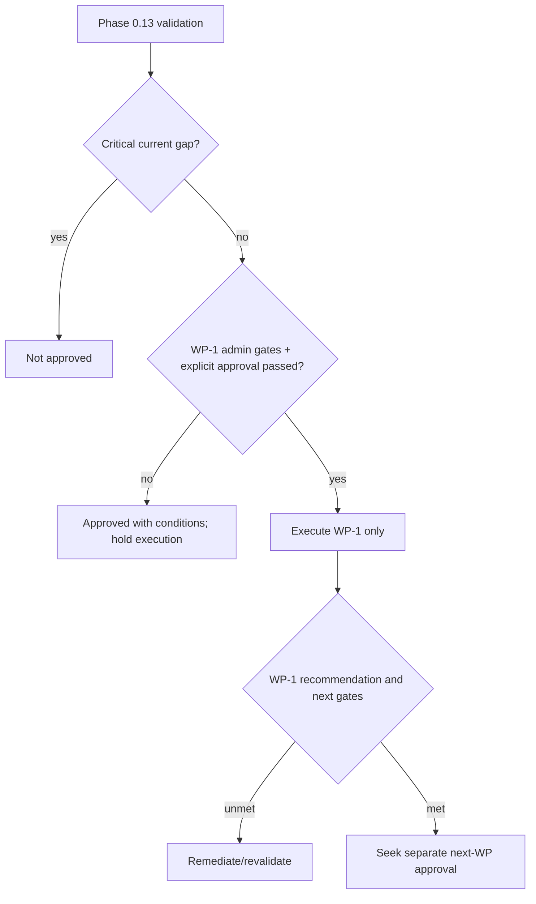
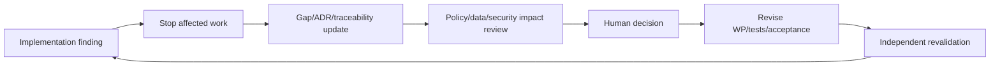

# Final Phase 1 Entry Recommendation

## Recommendation

**APPROVED WITH CONDITIONS**

WP-1 Foundation Baseline Verification may proceed only after C-01, C-08, C-14 and C-15 are Passed and explicit human development approval is recorded. Its existing instruction remains non-destructive and must produce the C-07 readiness result.

WP-2 is not pre-approved; it requires WP-1 GO/Conditional GO disposition and C-02 resolution for identifier-related work. WP-3 must be revised and split before approval. WP-4–10 remain blocked by their Phase 0.11 conditions and G-003–015 as applicable. All Wave 2+ business modules, migrations/imports not separately approved, records/signatures, production deployment, integrations, analytics and AI remain blocked.

## Approval conditions

| Condition | Permits when satisfied |
|---|---|
| C-01/08/14/15 + explicit approval | WP-1 only |
| WP-1 evidence/C-07 + separate approval | eligible consideration of WP-2 |
| C-02–04 + G-003 and split WP-3 | organization migration/work increments |
| C-05/06 + bootstrap audit | protected scope/role/audit work |
| C-13 | WP-9 shell acceptance |
| C-09–12 and module policy/security/data gates | affected later records/signature/production modules |

Phase 1 is not started automatically.

