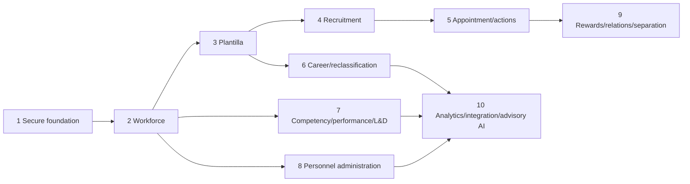

# Implementation Master Plan

## Wave roadmap

| Wave | Objective and included modules | Prerequisites / security / policy | Tests and acceptance | Principal risk / exit |
|---|---|---|---|---|
| 1 Core Platform | conventions; organization/offices/stations/ancestry; user-office context; auth integration; roles/permissions/Policies; audit; references; minimal policy registry; shell/navigation/errors; quality and safe seeders | Phase 0.11 gates; server scope; authority separation; approved sources | scope/Policy/audit/seeder/accessibility/build checks; human foundation acceptance | scope drift; exit only when WP-1–10 pass |
| 2 Workforce | employee core, personal/contact/government identifiers, status/category, office/position/appointment history, basic 201 link and service-record foundation | accepted Wave 1; privacy/retention and workforce logical model | history, serialization, office scope, sensitive access | data exposure; exit with auditable historical profile |
| 3 Plantilla/Position | titles/groups/grades/classifications/items/item numbers/funding/status/assignments/vacancy/staffing reports | Wave 2 identity; authoritative CSC/DepEd references | uniqueness, effective dates, vacancy and scoped report tests | bad reference data; exit with reconciled staffing truth |
| 4 Recruitment/Selection | vacancy request/authority/publication; applicant/application/documents/QS; evaluator/assessment/comparative evaluation/HRMPSB/ranking/recommendation/handoff | Waves 1–3; validated MSP/DepEd policy, concrete workflow/document foundation | assignment, recusal, deterministic scoring, snapshot, audit and volume tests | policy error; exit with approved handoff, not appointment |
| 5 Appointment/Personnel Actions | appointment preparation/documents/signing/CSC action/assumption/onboarding; promotion/transfer/reassignment/detail/designation | validated CSC/ORAOHRA; records/signature controls; recruitment handoff | authority, state/history, CSC action, document/audit tests | invalid official action; exit with immutable action history |
| 6 Career Progression/Reclassification | distinct expanded career, teacher, Master Teacher, Principal, reclassification, retitling, conversion, evidence and comparative/non-comparative paths | policy-validated pathways, plantilla/competency/evidence | path-specific eligibility, evidence, authority and snapshot tests | improper merging; exit separately per pathway |
| 7 Competency/Performance/L&D | dictionary/profiles/assessments/gaps/IDPs/interventions/SPMS, promotion/succession readiness | verified CBHRMS/SPMS frameworks and workforce/position data | framework version, assessment, privacy and advisory-readiness tests | unverified framework; exit with reusable competency backbone |
| 8 Personnel Administration | 201 files, service records, leave, attendance, payroll preparation, ESS, requests/certifications/reports | records/storage/retention, integrations and relevant policies | ledger/history, restricted file/export, reconciliation tests | privacy/record loss; exit with approved operational controls |
| 9 Rewards/Relations/Separation | PRAISE/awards, restricted relations/case links, grievance, separation/retirement/clearance/turnover | policy/legal/records authority and restricted-data design | SoD, restricted access, disposition/turnover and history tests | unauthorized disclosure; exit per module sign-off |
| 10 Analytics/Integration/Advisory AI | scoped dashboards/PRIME-HRM/workforce/competency analytics; policy KB; AI assistance; external/mobile integration | mature data/lineage, approved metrics/sources/providers, privacy/security/bias/accuracy review | freshness/lineage/scope, adapter failure, explainability/human-review tests | premature automation; exit only after controlled pilot approval |

Excluded from each wave are all later-wave modules and any unapproved generic engine, external dependency or production import.

Each wave requires approved scope, traceability, logical data model, authorization matrix, audit events, tests, rollback/recovery and human exit approval. Acceptance never authorizes the next wave automatically.

