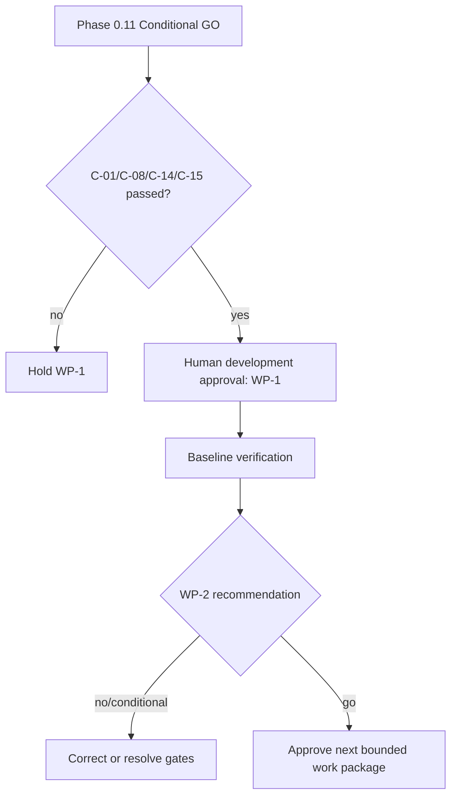

# Phase 1 Mobilization Plan

## Phase 0.11 condition resolution

| Gate | Owner | Resolution | Verification | Blocks |
|---|---|---|---|---|
| C-01 decision/named owners | Project/System Owner | approve Conditional GO and name accountable reviewers | signed decision record | WP-1 |
| C-02 identifiers | Architect/DB Reviewer | approve internal/public/reference strategy | ADR + examples/collision/privacy review | first migration |
| C-03 organization/scope model | Organization Owner/Architect/Security | approve cardinalities, ancestry, effective dates and scope contract | schema walkthrough + hierarchy scenarios | organization migration |
| C-04 references/sources | Data/Policy Owners | freeze initial catalogs, provenance, stewards and classifications | source register approval | seeding |
| C-05 authorization | Security/HR Owner | freeze Phase 1 permission/Policy/scope/authority matrix | executable test matrix review | protected features |
| C-06 audit minimum | Governance/DPO/Records | approve fields, redaction, sensitive actions and retention owner | audit event catalog review | mutations |
| C-07 baseline | Lead Developer/QA | execute WP-1 inspection/checks | WP-1 report and recommendation | WP-2 onward |
| C-08 scope/change control | Project Owner/Architect | approve Phase 1 scope, exclusions, backlog and control | recorded approval | WP-1 |
| C-09–11 later-policy/records/signature | Records/Legal/Policy/HR/Security | formal validation before affected module | signed module gate evidence | affected later module |
| C-12 production environment | Deployment Admin | evidence secrets, backup/restore, monitoring, DR | restore exercise and readiness report | production |
| C-13 accessibility | UI/QA | approve WCAG-oriented protocol | component checklist/tool evidence | shell completion |
| C-14 RAID ownership | Project Owner | name owners and accept mitigations | RAID review minutes | WP-1 |
| C-15 clean baseline | Lead Developer/Codex Operator | commit/isolate unrelated work | Git status/baseline reference | coding |

## Mobilization sequence

1. Record architecture approval for Phase 0.11 and ADRs.
2. Record development approval for WP-1 only; freeze Phase 1 inclusion/exclusion.
3. Confirm domains, database naming, identifiers, office scope, authorization, audit, registry and shell contracts.
4. Confirm authoritative seed sources and quality commands.
5. Approve WP-1–10 order, acceptance criteria, RACI, RAID and change control.
6. Issue the instruction in document 23 and perform WP-1 only after explicit authorization.
7. Use WP-1 evidence to decide whether WP-2 is ready.

Architecture approval accepts design. Development approval authorizes a bounded work package. Migration approval authorizes reviewed schema execution in a named environment. Production approval authorizes an accepted release and deployment. None implies another.

