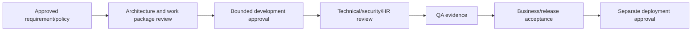

# Delivery Governance Framework

## Roles

Project Owner funds/prioritizes and accepts program risk; System Owner owns service outcomes; HR Process Owner validates business outcomes; DepEd Policy Validator confirms sources/interpretation; Technical Architect protects boundaries/ADRs; Lead Developer integrates implementation; Security Reviewer approves controls; DPO reviews privacy; Records Reviewer approves classification/retention; DB Reviewer approves schemas/migrations; UI/UX Reviewer approves accessibility/consistency; QA Reviewer owns test evidence; Deployment Admin controls environments/releases; Codex Operator issues bounded instructions and verifies reports; Business Acceptance Reviewer coordinates UAT/sign-off.

## RACI

Legend: A accountable, R responsible, C consulted, I informed. PO Project Owner; SO System Owner; HR HR Owner; PV Policy Validator; TA Architect; LD Lead Developer; SR Security; DP DPO; RR Records; DB Database; UX UI; QA Quality; DA Deployment; CO Codex Operator; BA Business Acceptance.

| Decision | A | R | C | I |
|---|---|---|---|---|
| Requirements approval | PO | HR/BA | SO, PV, TA | delivery roles |
| Policy interpretation | PV | PV/HR | legal/records/DPO | TA, LD, CO |
| Architecture change | TA | TA | HR, PV, SR, DB | PO, delivery roles |
| Database design | TA | DB/LD | domain owner, SR, DP | QA, DA |
| Migration approval | SO | DB/DA | TA, SR, QA | PO, HR |
| Security/permission approval | SO | SR | HR, TA, DP | LD, QA, CO |
| Workflow approval | HR | HR/PV | TA, SR, RR | LD, QA |
| Document template | HR | RR/HR | PV, DP, UX | LD, QA |
| Test approval | QA | QA | LD, SR, HR | PO, SO |
| Release approval | SO | BA/QA | HR, SR, DP, RR, DA | PO |
| Production deployment | SO | DA | QA, SR, DB | PO, users |
| Data migration | Data Owner | DB/DA | HR, DP, RR, QA | PO, SO |
| Incident response | SO | SR/DA | DP, RR, TA | PO, affected owners |
| Risk acceptance | PO/SO | relevant control owner | SR, DP, HR, TA | delivery roles |

Developers, Codex and system administrators may recommend or implement approved behavior but cannot approve HR policy, official decisions, migration reconciliation, residual security/privacy risk or production deployment.

