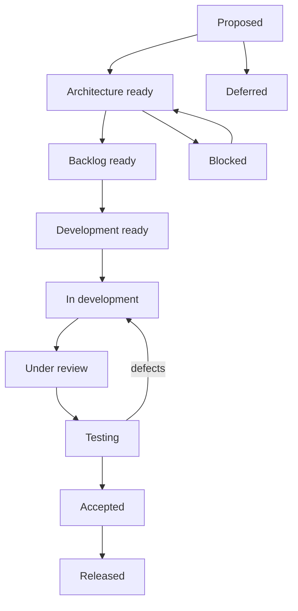

# Development Workstream Model

| Workstream | Scope | May run in parallel | Must wait / conflicts | Checkpoints |
|---|---|---|---|---|
| A Core Platform | organization, auth integration, office scope, permissions, audit, references | B component design, C registry design, D quality | schemas wait for identifiers/org model; shared auth/User/routes/migrations are high-conflict | logical model, security, migration and integration reviews |
| B Shell/UI | layout, navigation, headers/forms/tables/filters/status/accessibility | design tokens/components alongside A | office switcher/nav integration waits for A contracts; shared layouts/types are conflict points | UX/accessibility, typed-prop and browser review |
| C Policy/Configuration | registry, versions, effective dates, sources/references | conceptual work with A/B | persistence waits for identifiers/authority; no rules engine | policy/records/security review |
| D Quality/Security | tests, static analysis, scope/Policy checks, CI commands | continuous across all | acceptance waits for integrated code | per-PR and work-package gate |
| E Infrastructure | local/test config, queue/storage/backup/release conventions | planning and sandbox independently | production waits for approved platform, secrets and controls | environment and release readiness |

Only one workstream may own a shared migration, route, global type, navigation registry or authorization contract at a time. Database changes are sequenced by foreign keys and cannot be parallelized against an unstable owning entity. Integration checkpoints occur after contract review, before merge, and at work-package acceptance.

