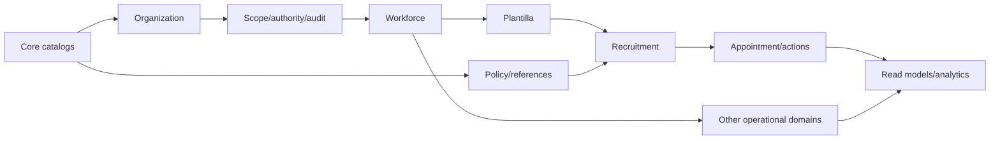

# Database Migration and Seeding Plan

No migration is created in Phase 0.12. C-02–C-04 and database review must pass first.

## Migration waves

| Wave / order | Constraints, indexes and history | Transition/rollback/safety | Tests |
|---|---|---|---|
| 1 Core | catalogs → office types → offices/hierarchy/stations → user-office context → permission integration → audit support → references → policy/version | public IDs and scoped unique codes; parent/status/effective indexes; nullable only for staged backfill; completed history not soft-deleted | FK/unique/check behavior, hierarchy/scope, rollback expectation, seeder and query tests |
| 2 Workforce | employees → identifiers/contacts → employment → office/position/appointment histories | sensitive uniqueness/encryption review; effective-date overlap rules; append corrections | privacy, serialization, overlap, scope and history tests |
| 3 Plantilla | title/group/grade → items → assignments → vacancy status | official item uniqueness and provenance; assignment history immutable | uniqueness, vacancy, effective dates and report-scope tests |
| 4 Recruitment | vacancy → applicant/application → requirements/QS → assessments/deliberation/results | policy/config snapshots and case IDs; no cascade loss | workflow, snapshot, concurrency, volume and audit tests |
| 5+ Later | appointment/actions → career → competency → documents → leave/attendance/performance/L&D → analytics read models | domain-specific approval; private binary storage separate; reversible deployment or documented forward repair | migration/reconciliation/authorization/history tests per domain |

Every migration proposal lists FK order, nullable/backfill/drop phases, temporal uniqueness, indexes, deletion/history policy, estimated volume/lock risk, backup/recovery, rollback or forward-repair procedure, environment and approvals. Destructive changes require explicit data-owner and migration approval.

## Seeder categories

| Data | Category | Gate |
|---|---|---|
| office/policy/workflow/document types; permission catalog; initial roles | production required where approved | source/owner/version and security review |
| personnel categories, position groups, appointment/employment statuses, salary grades, plantilla types, national references | production required/optional by approved scope | authoritative DepEd/CSC source and effective dating |
| local units/stations/configuration | office-specific | scoped steward approval; import/maintenance rather than global assumptions |
| documentary/assessment configuration | policy-version specific | verified policy version and HR approval |
| synthetic offices/users/scenarios | development/test/demo only | prohibited in production |

Production seeders are deterministic, idempotent, traceable, reviewable, non-destructive, safe to rerun and tested when critical. Changed official values are superseded/effective-dated rather than overwritten.

