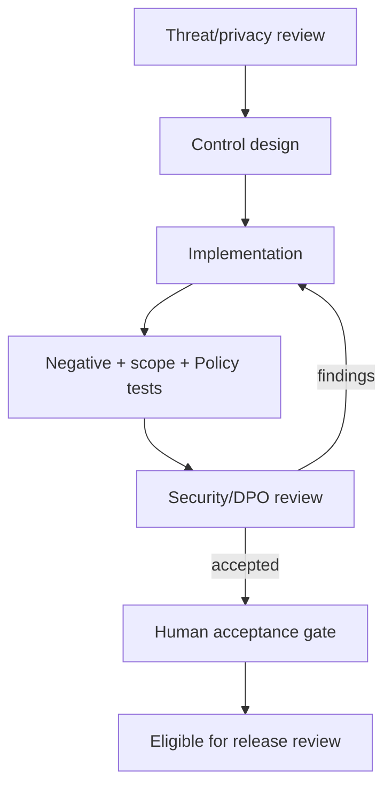

# Security-First Implementation Plan

## Delivery order

1. WP-1 verifies existing authentication, email verification where applicable, password/session/CSRF/rate-limit behavior and security headers without changing auth.
2. Implement approved office assignments, active context and ancestry resolver server-side.
3. Apply scoped queries plus Laravel Policies and fine-grained permissions; UI hiding remains secondary.
4. Add temporary/delegated/acting authority and segregation-of-duties rules where approved.
5. Add audit context, reason/old-new values for sensitive actions, correlation IDs and access monitoring.
6. Before affected modules, approve restricted-record/export/file controls, encryption, private storage and alerting.

## Authorization test matrix

| Case | Expected result/evidence |
|---|---|
| same-office authorized | allowed by permission + Policy + scope; action audited when sensitive |
| same-office unauthorized | 403; no mutation or sensitive disclosure |
| cross-office | denied in route, query, search, export and autocomplete |
| regional oversight | allowed only to authorized descendant scope and action |
| division oversight | allowed only within division ancestry |
| school/IU access | restricted to assigned scope; no division-wide inference |
| assigned workflow/evaluator | case access limited to active assignment and role |
| unassigned/recused/closed cycle | denied or approved archival view only |
| temporary/delegated/acting authority | allowed only during valid dates/scope; delegator/acting identity audited |
| technical administrator HR approval | denied absent separate explicit business authority |
| own employee/applicant record | only approved self-service fields/actions |
| restricted file/export | classification + reason/permission/scope; access/export audit |

No critical/high authorization defect, scope leak, unprotected sensitive route, serialization leak or missing audit control may pass a work-package gate.

