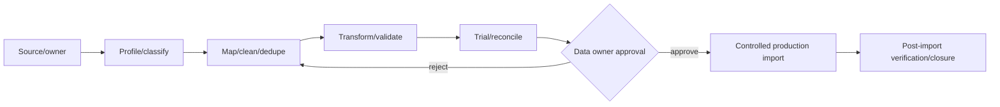

# Data Migration Delivery Strategy

Legacy import is not authorized in Phase 0.12 or initial Phase 1.

Source inventory → ownership confirmation → controlled extraction → profiling/classification → mapping/versioned crosswalk → cleaning → deduplication → transformation → validation → trial migration → reconciliation → human approval → production import → post-import verification → issue resolution → closure.

Every row/batch preserves source reference, batch, extraction/import dates, importing actor, mapping version, validation/error status, original source value where justified, correction/reason, approval and audit. Sensitive staging data is access-controlled, encrypted where approved, time-limited and securely disposed. Historical effective dates and provenance survive transformation. Rollback may be batch reversal before downstream use or documented correction/compensation after official use; silent overwrite is prohibited.

