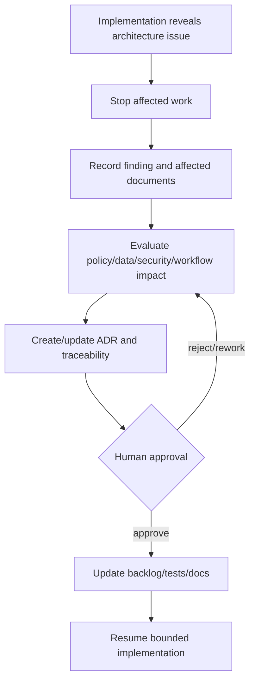

# Branching, Commit, and Change Control

Use a simple mainline workflow unless team size proves a persistent development branch necessary. `main` remains releasable; short-lived `feature/<work-package>-<slug>`, `fix/<slug>`, `docs/<slug>` and urgent `hotfix/<slug>` branches merge by reviewed pull request. Release branches are exceptional for concurrent stabilization only.

Commits are coherent and use existing prefixes such as `feature:`, `fix:`, `test:`, `docs:`, `refactor:` and `chore:`. PRs state scope/reason/work package, architecture/policy references, tests, screenshots, database/migration, permission/office scope, audit, security/privacy and rollback impacts. Avoid unrelated refactoring.

Architecture is never silently changed through code. Emergency fixes receive retrospective ADR/traceability review if they alter a boundary or risk decision.
