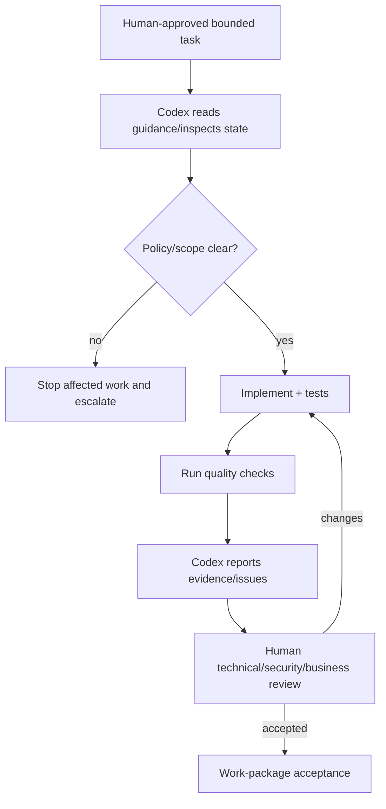

# Codex Task and Prompt Governance

Each instruction implements one coherent, reviewable work package. It requires reading `AGENTS.md`, relevant `.codex` guidance, architecture/ADRs and existing code; identifies files before editing; preserves unrelated behavior; respects domain ownership; uses Form Requests, thin controllers and actions/services only when justified; enforces server-side scope and Laravel Policies; implements audit/events; adds tests; runs approved checks; and reports changed files, evidence and unresolved issues. Codex must not invent policy, approve risk or expand scope.

## Standard task template

```text
Task title / Work Package ID
Objective and business outcome
Required reading and existing-state inspection
Scope / Out of scope
Architecture, ADR, requirement and validated policy references
Owning domain and affected contracts
Files expected (confirm after inspection)
Database changes and separate migration approval
Backend and validation requirements
Authorization, office scope, business authority and audit requirements
Events, workflow, documents and integrations
Frontend/accessibility requirements
Testing scenarios and quality commands
Acceptance criteria and Definition of Done
Prohibited changes / stop conditions
Required human reviews
Final report: files, tests, results, limitations, unresolved issues
```



Prohibited prompts include “build the whole HRIS,” multiple unrelated domains, “refactor everything,” or “make production ready.” Split them by dependency, acceptance boundary and reviewer.

