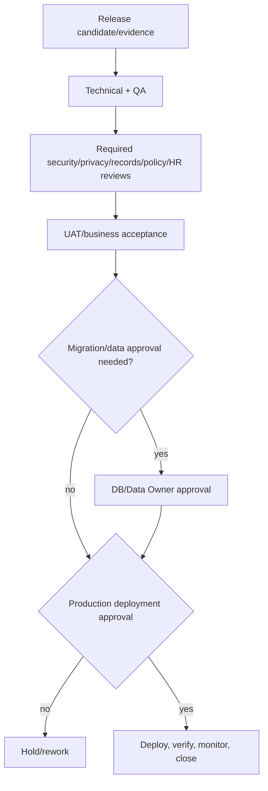

# Release Acceptance and Sign-Off

## Acceptance package

Release ID/version; included/excluded work packages; requirements/policies/architecture/ADRs; schema migrations and seeders; security/privacy/records reviews; test/build results; known limitations/open issues; deployment prerequisites/steps; backup/rollback/forward-repair; release notes/changelog; user/admin documentation; acceptance decisions with names/dates.

## Sign-off matrix

| Sign-off | Owner | Required when | Evidence |
|---|---|---|---|
| Technical | Lead Developer/Architect | every release | review, quality results, architecture impact |
| Security | Security Reviewer | protected routes/data/integrations | threat/control and negative-test review |
| Privacy | DPO | personal/sensitive data/use/export | classification, minimization and privacy assessment |
| Records | Records Reviewer | official documents/retention/disposition | schedule/template/lifecycle approval |
| HR process | HR Process Owner | HR behavior/output | scenario/UAT acceptance |
| Policy | DepEd Policy Validator | policy-sensitive rules/workflows | source/provision/version validation |
| QA/UAT | QA and Business Acceptance | test/UAT/pilot releases | test report, defect disposition |
| Database/migration | DB Reviewer/Data Owner | schema/data change | migration/reconciliation/rollback approval |
| Deployment | System Owner/Deployment Admin | production/hotfix | environment, backup, monitoring and runbook |

Not every release requires every specialist, but the release risk classification explicitly selects and justifies sign-offs. No role may self-approve an incompatible duty.

