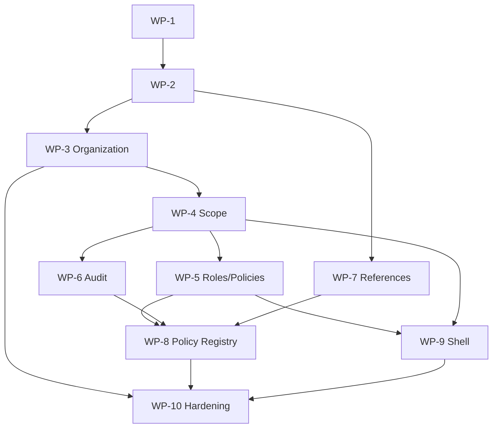

# Phase 1 Backlog and Work Packages

Work packages are ordered. A downstream package cannot become Development Ready until predecessor gates pass.

| WP | Objective / dependencies | Deliverables and expected areas | Acceptance/tests/security/audit | Out of scope / completion gate |
|---|---|---|---|---|
| WP-1 Baseline Verification | establish factual baseline; C-01/08/14/15 + explicit approval | environment/package/routes/auth/Inertia/React/tests/scripts/database-config summary; docs only unless separately approved correction | non-destructive tests/static/types/lint/build; no secrets; GO/conditional/no-go for WP-2 | no modules/migrations; accepted report + C-07 disposition |
| WP-2 Shared Conventions | approved WP-1; settle folders, identifiers, dates/timezone, enums/value objects and audit metadata | convention docs/ADRs and only justified shared primitives/tests | architecture/static/unit review; no speculative base classes | no domain entities; C-02 and convention sign-off |
| WP-3 Organization Reference | WP-2; C-02–04 | approved schema/migrations/models/requests/actions/Policies/routes/pages only when separately authorized; office types/hierarchy/stations/effective status | FK/unique/history, Policy, scope, validation, audit, seeder tests | no employees; logical/migration/security/data-owner acceptance |
| WP-4 Office Scope | accepted WP-3; C-03/05 | user-office assignments, primary/active context, ancestry and server scope service | same/cross/oversight/inactive/switch tests; assignment/context audit | no business modules; Security/DPO acceptance |
| WP-5 Roles/Permissions | WP-4; C-05 | approved permission catalog/roles/assignment/Policies, authority separation | permission/Policy/temporary authority/technical-admin denial tests; role-change audit | no HR approvals; HR/Security acceptance |
| WP-6 Audit Foundation | WP-4/5; C-06 | activity conventions/context/acting capacity/correlation/sensitive-action helpers | redaction, old/new/reason/context and failure tests | no domain event catalog beyond approved minimum; Governance/DPO/Records acceptance |
| WP-7 Reference Data | WP-2/3; C-04 | approved shared catalogs, effective status, production-safe and synthetic seed separation | idempotency/rerun/provenance/uniqueness tests; change audit | no unverified national values; Data/Policy acceptance |
| WP-8 Policy Registry | WP-5–7; approved minimal model | classifications, policy/version/effective/supersession/source-link status, authorization/audit | version/applicability/status, Policy and snapshot-foundation tests | no generic rules/scoring engine; Policy/HR/Records acceptance |
| WP-9 Application Shell | WP-4/5; C-13 | authenticated layout/sidebar/header/breadcrumbs/office switcher/nav/states/components | typed props, role/scope, browser/responsive/keyboard/focus/contrast/build | no business pages; UI/Security/QA acceptance |
| WP-10 Integration/Hardening | accepted WP-3–9 | regression, security/scope/seeder/migration review, docs and Phase 1 acceptance report | full quality suite, threat/privacy review, no critical/high defect | no Wave 2; all required human sign-offs |

## Common traceability and completion gate

Each WP declares requirement/policy/architecture/ADR references, domain owner, files, data changes, permissions, office scope, audit, events/documents, tests, limitations and acceptance criteria. Any migration requires separate approval. DoD document 18 and the relevant specialist sign-offs apply to every WP.

