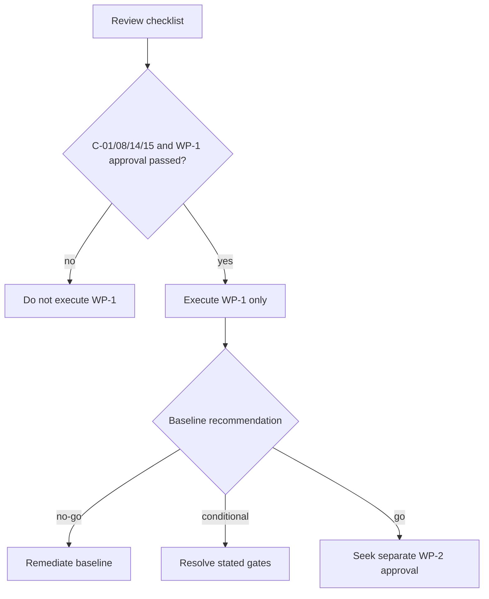

# Phase 1 Entry Checklist

Statuses: Passed, Failed, Conditional, Not applicable, Pending. This is a live approval record; role labels must be replaced by named approvers.

| Check | Status | Owner/evidence and effect |
|---|---|---|
| Phase 0.11 outcome reviewed/approved | Pending | Project/System Owner; C-01 blocks WP-1 |
| Phase 0.11 blockers resolved or formally deferred with scope effect | Conditional | Red later areas deferred; Phase 1 conditions still open |
| Phase 1 scope and exclusions approved | Pending | Project Owner/Architect; C-08 blocks WP-1 |
| WP-1–10/order/acceptance approved | Pending | Project/Technical/HR owners |
| Architecture/ADRs and domain ownership confirmed | Conditional | package exists; human confirmation pending |
| Identifier strategy confirmed | Failed | C-02; blocks migrations |
| Organization/office-scope design confirmed | Failed | C-03; blocks WP-3 migration/WP-4 |
| Migration sequence confirmed | Conditional | documented; DB approval pending |
| Permission/Policy/business-authority strategy confirmed | Failed | C-05; blocks protected features |
| Audit minimum strategy confirmed | Conditional | C-06 fields/redaction/retention owner pending |
| Policy registry minimum confirmed | Conditional | scope documented; Policy/HR approval pending |
| Seed-data sources/stewards identified | Failed | C-04; blocks production seeders |
| Testing commands verified | Pending | C-07 is WP-1 outcome |
| Quality gates approved | Pending | QA/Lead Developer |
| Git workflow/change control confirmed | Conditional | documented; team approval pending |
| Local environment works | Pending | WP-1 evidence |
| Current baseline committed/identified | Pending | C-15; blocks coding |
| No unrelated uncommitted changes overlap | Pending | Lead/Codex Operator; isolate user work |
| Backup/recovery plan before migrations | Pending | DB/Deployment; required before migration execution |
| RAID owners and mitigations accepted | Pending | C-14 blocks WP-1 |
| Explicit human approval to begin WP-1 | Pending | Project/System Owner |

## Current result

**Not yet eligible to execute WP-1.** The plan is ready, but C-01, C-08, C-14, C-15 and explicit human development approval remain Pending. This results in the Phase 0.12 recommendation **READY WITH CONDITIONS**.

