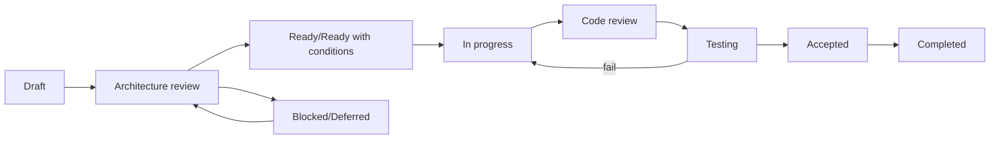

# Backlog Governance

Hierarchy: Phase 1 → Epic → Work Package → implementation tasks → test/acceptance evidence. A work package owns one coherent outcome and produces an independently reviewable commit or small series.

Statuses: Draft, Under architecture review, Ready, Ready with conditions, Blocked, In progress, Under code review, Under testing, Accepted, Rejected, Deferred, Superseded, Completed. Ready requires accepted dependencies, exact references, testable criteria, permission/scope/audit/test definitions, and no Critical or blocking High gap.

Priorities: P0 blocking foundation/remediation; P1 required Phase 1; P2 important non-critical sequence; P3 optional/deferred. Complexity uses Small/Medium/Large; Large packages must be challenged and normally split.

The Backlog Owner maintains status/dependencies; Domain Owner validates ownership; Architect validates boundaries/ADRs; HR/Policy owners validate business rules; Security/DPO/Records validate controls; DB Reviewer approves schema/migrations; QA approves evidence; Codex Operator executes only an explicitly approved package. Architecture, development, migration and production approvals remain separate.

