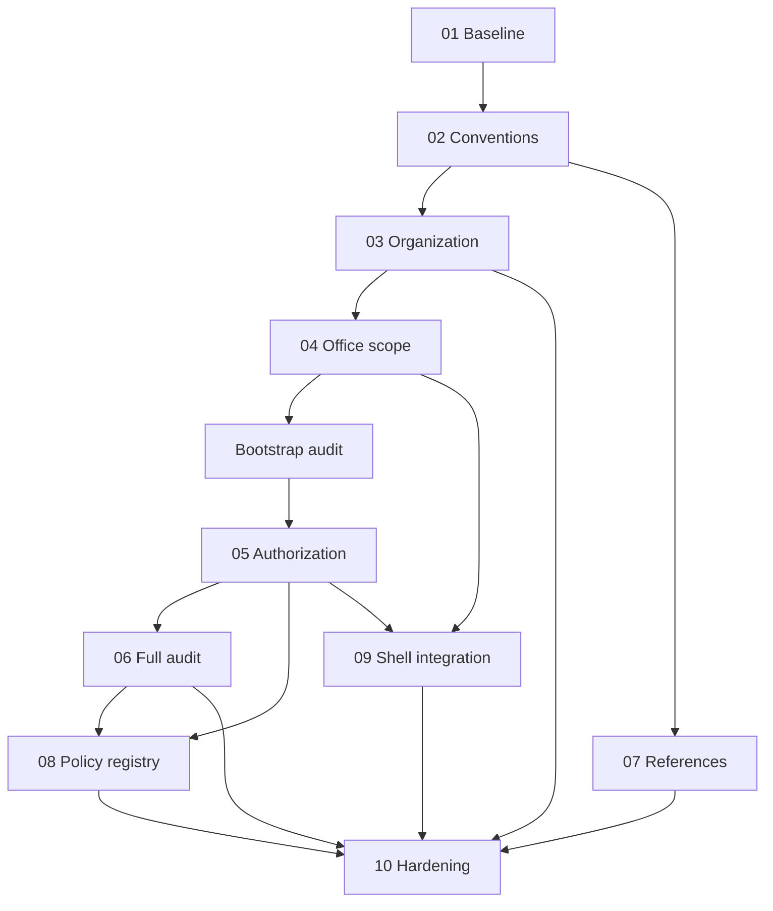

# Phase 1 Epic Map

| Epic | Capability/outcome | Phase 0.13 disposition |
|---|---|---|
| EPIC-01 Foundation Baseline | verified repository/auth/toolchain baseline | first package conditionally permitted |
| EPIC-02 Shared Conventions | approved IDs, temporal/status/audit/error/folder conventions | blocked by WP-1 and C-02 |
| EPIC-03 Organization Hierarchy | effective-dated DepEd office hierarchy | split into 13 packages; blocked by C-02–04/G-003 |
| EPIC-04 Office Scope | assignments/context/ancestry/server authorization | blocked by accepted organization and C-05 |
| EPIC-05 Roles/Permissions/Policies | least-privilege capability and business authority | blocked by scope contract/bootstrap audit |
| EPIC-06 Audit | attributable, contextual, queryable foundation | bootstrap subset precedes privileged changes; full epic conditional |
| EPIC-07 Reference Data | classified, sourced, effective, safely seeded references | blocked by C-04 |
| EPIC-08 Policy Registry | minimum versioned registry, not Rules Engine | blocked by authorization/audit/references |
| EPIC-09 Application Shell | accessible, responsive, context-aware shell | base layout may follow baseline; secure integration waits for scope/permissions |
| EPIC-10 Hardening | separately reviewable integrated acceptance evidence | split review packages; last |

