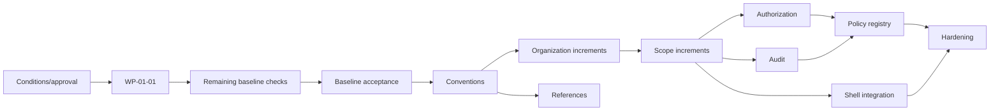

# Phase 1 Dependency Map

Work-package dependencies are recorded in each package. Key gates:

| Predecessor | Unlocks | Condition |
|---|---|---|
| WP-01-01–05 | WP-01-07 / remediation decision | verified evidence; WP-01-06 only if approved defects exist |
| WP-01-07 | EPIC-02 consideration | C-07 disposition and separate approval |
| WP-02-01–07 | EPIC-03/07 design | identifiers and conventions accepted |
| WP-03-01–05 | organization persistence | C-02–04, restructuring/history rules |
| WP-03-13 | EPIC-04 | organization accepted |
| WP-04-01–06 + bootstrap audit | context switching and authorization | C-05/06 control evidence |
| WP-04-11 | EPIC-05 integrated authorization | scope security accepted |
| EPIC-05/06/07 | EPIC-08 | authority, audit and references stable |
| EPIC-04/05 | context-aware portions of EPIC-09 | server contracts accepted |
| all included epics | EPIC-10 | mandatory WPs accepted |

