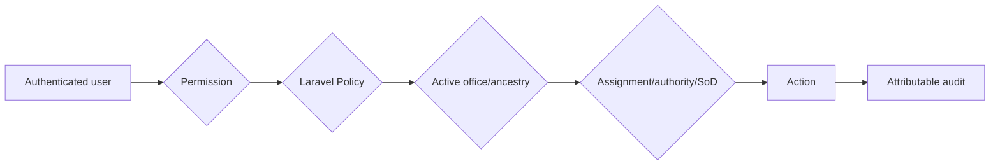

# Phase 1 Permission Catalog

Names follow plural kebab-case resource plus dot action. Defaults are proposals requiring C-05 HR/Security approval; “System Administrator” never implies business authority.

| Permission | Purpose/default role proposal | Scope/Policy/sensitivity/audit | Introduced/tested |
|---|---|---|---|
| `organizations.view` | view organization; authorized users | assigned/oversight ancestry; `viewAny/view`; no | WP-03-08/12 |
| `organizations.create` | create office; Organization Steward | authorized parent scope; `create`; sensitive/audit | WP-03-08/09/12 |
| `organizations.update` | update office; Steward | record scope; `update`; audit | WP-03-08/09/12 |
| `organizations.archive` / `.restore` | lifecycle; Senior Steward | authority + descendants/dependencies; `archive/restore`; reason/audit | WP-03-08/09/12 |
| `organizations.manage-hierarchy` | reparent/effective change; approved steward | parent and child scopes; special Policy; highly sensitive | WP-03-04/08/12 |
| `office-assignments.view/manage` | view/assign/remove/primary | user + office scope; Policy/SoD; sensitive audit | WP-04-01/02/06/09 |
| `office-context.switch` | choose active authorized office | own valid assignment; `switchContext`; audit | WP-04-06–09 |
| `offices.view-descendants` | oversight read | explicit ancestry permission; Policy | WP-04-05/06/09 |
| `office-scope.manage-cross-office` | exceptional scope | named business/security authority; reason/audit | WP-04-06/10 |
| `roles.view/create/update/assign` | security administration | role Policy, SoD, office applicability; sensitive audit | WP-05-01–05/10 |
| `permissions.view/grant/revoke` | permission administration | Security Administrator only with approved constraints; sensitive audit | WP-05-01/05/10 |
| `delegated-authorities.view/manage` | dated acting/delegated authority | delegator/subject/scope validity; highly sensitive audit | WP-05-07/10 |
| `audit-logs.view-own/view-office/view-restricted/export` | controlled audit access | progressively restricted scope; access/export audit | WP-06-07/08/10 |
| `reference-data.view/manage-office/manage-national/archive` | reference stewardship | national versus office owner; Policy; changes audited | WP-07-11/14 |
| `policies.view/register/update-draft/verify/approve/activate/supersede/archive` | segregated registry lifecycle | applicability office/national scope; maker-checker; sensitive audit | WP-08-07–09/13 |
| `policy-sources.view-restricted` | restricted source access | classification clearance; access audit | WP-08-06/13 |

Every test includes permission absent, correct permission but wrong office/record scope, technical administrator without business authority, and expired delegation where applicable.

