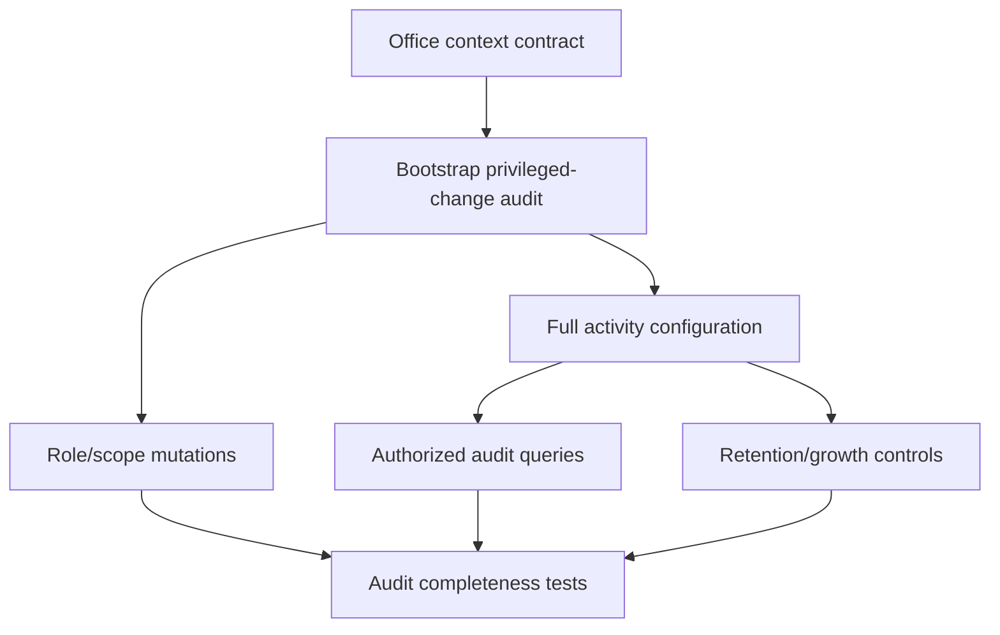

# Phase 1 Audit Event Catalog

All entries capture actor/user, role, acting capacity, active office, subject/entity ID, timestamp, correlation ID and sensitivity. Old/new values and reason/basis are required when material; secrets and unnecessary sensitive data are redacted. Retention remains C-06/records-approved.

| Event/activity | Trigger / values/reason | Sensitivity / introduced |
|---|---|---|
| `OfficeTypeCreated/Updated` | catalog mutation; old/new; reason for update | internal; WP-03-02 |
| `OfficeCreated/Updated/Archived/Restored` | office lifecycle; old/new; archive/restore reason | sensitive; WP-03-03/05/09 |
| `OfficeHierarchyChanged` | effective reparent/restructure; old/new parent/effective date/reason | high; WP-03-04/05 |
| `UserOfficeAssigned/AssignmentRemoved` | assignment authority/dates; reason | high; WP-04-01/06 |
| `PrimaryOfficeChanged` | prior/new primary; reason | high; WP-04-02 |
| `ActiveOfficeContextChanged` | prior/new context | security-relevant; WP-04-03/07 |
| `RoleCreated/Updated/Assigned/Removed` | role/subject/scope; old/new/reason | high; WP-05-02/04 |
| `PermissionGranted/Revoked` | permission/role-or-user/scope/reason | high; WP-05-05 |
| `DelegatedAuthorityCreated/Revoked/Expired` | delegator/subject/scope/dates/reason | restricted; WP-05-07 |
| `AuditHistoryViewed/Exported` | query scope/purpose/export metadata | restricted; WP-06-07/08 |
| `ReferenceDataCreated/Updated/Archived` | source/version/old-new/reason | internal/high by catalog; WP-07 |
| `PolicyRegistered/Updated/Verified/Approved/Activated/Superseded/Archived` | version/status/source/applicability/basis and maker-checker actors | high; WP-08 |
| `RestrictedPolicySourceViewed` | policy/source/purpose | restricted; WP-08-06 |

Audit activities are not automatically domain events. Events are introduced only when a legitimate consumer exists. Bootstrap audit for office/role authority changes is a P0 dependency.

