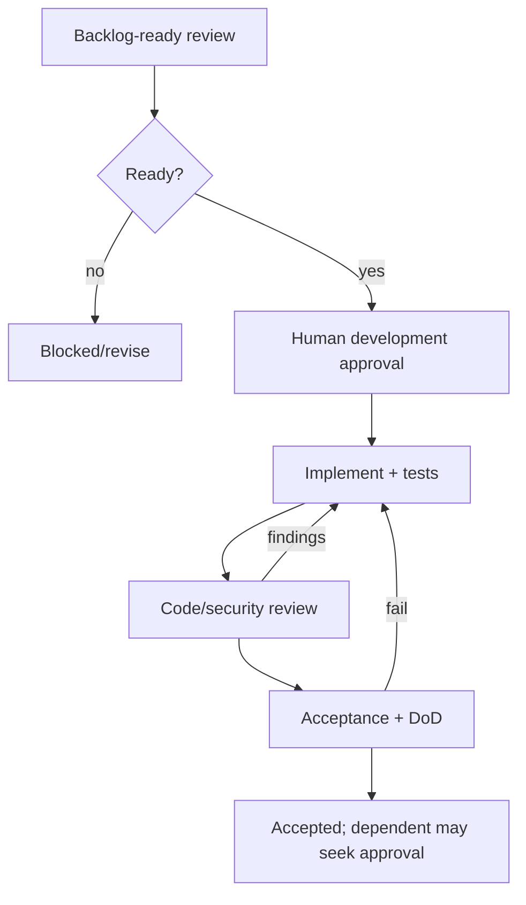

# Phase 1 Acceptance Gates

| Gate | Entry/evidence | Exit/block |
|---|---|---|
| Backlog Ready | dependencies Accepted; exact scope/references/policy status/data/permissions/scope/audit/tests/docs/criteria; no blocker | reviewer marks Ready; unresolved High remains Blocked |
| Development approval | clean branch/baseline; human authorization; migration/package approvals separate | work may start only within package |
| Code review | scope/boundaries/validation/security/audit/tests and quality evidence; no unrelated changes | findings resolved; no UI-only auth |
| Acceptance | all criteria + DoD; docs/evidence/human reviews; no Critical/blocking High | Accepted or Rejected, never silently partial |
| Epic closure | mandatory WPs Accepted; integrated/security/docs review; deferrals registered | epic accepted by accountable owner |
| Slice/release | included epics/gates, rollback, release evidence/sign-offs | separate release/deployment approval |

