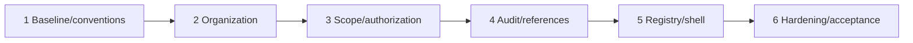

# Phase 1 Release Slices

| Slice | Included outcome | Entry / exit and gates | Rollback consideration |
|---|---|---|---|
| 1 Baseline/Conventions | EPIC-01 + accepted EPIC-02 parts | WP-1 approval; verified tools/auth; convention/ADR evidence; no code unless approved | revert documentation/config corrections independently |
| 2 Organization | EPIC-03 split WPs | IDs/logical model/source approved; schema/backend/UI/tests accepted | migration rollback/forward repair and no destructive history |
| 3 Scope/Authorization | EPIC-04/05 + bootstrap EPIC-06 | organization accepted; C-05/06; cross-office/admin/expired authority tests | disable new protected routes/assignments; preserve audit |
| 4 Audit/References | remaining EPIC-06 + EPIC-07 | scope/authority stable; C-04/06 | non-destructive reference supersession; audit preservation |
| 5 Policy Registry/Shell | EPIC-08/09 | authority/audit/references and C-13; registry/shell security tests | deactivate new UI/routes safely; preserve policy history |
| 6 Hardening | EPIC-10 | all mandatory packages substantially Accepted | release-specific backup/rollback/forward repair |

Each slice requires QA, security, documentation and applicable data/privacy/business sign-off. A slice is an acceptance boundary, not automatic production deployment.

